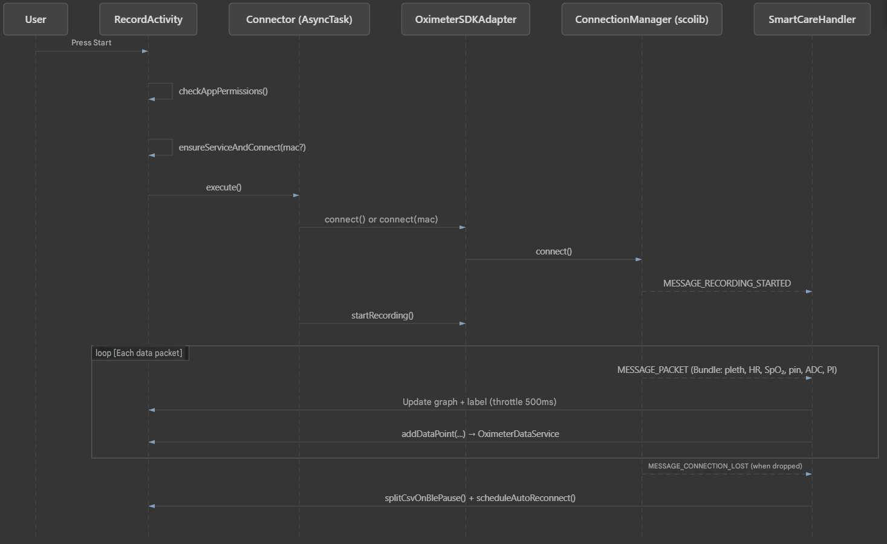

# Flow 02 — Bluetooth Connection

> **Tier 2 · Flow 2.** How the app scans, connects, keeps, and auto-reconnects to the oximeter via BLE — with the vendor library isolated behind `OximeterSDKAdapter`.

---

## 1. Summary

- The app connects via a **proprietary manufacturer BLE library**, wrapped by **`OximeterSDKAdapter`** (implements `IDeviceAdapter`).
- The library reports events/data back to the app as **`android.os.Message`** on a **`Handler`** (`RecordActivity.SmartCareHandler`) — not via the legacy `OximeterDataListener` interface.
- The app implements **background scanning** and **auto-reconnection**, while **filtering BLE events from unexpected devices** using `BluetoothEventInterceptor`.
- **`PacketStatsTracker`** (on `MESSAGE_PACKET`) tracks device `KEY_DATA_COUNTER` gaps, writes minute summaries to `FileLogger`, and ignores implausible gaps above `MAX_PLAUSIBLE_GAP = 1000`.

---

## 2. Sequence diagram — connect & receive data

```mermaid
sequenceDiagram
    participant U as User
    participant RA as RecordActivity
    participant CN as Connector (AsyncTask)
    participant ADP as OximeterSDKAdapter
    participant SDK as Vendor BLE library
    participant H as SmartCareHandler

    U->>RA: Press Start
    RA->>RA: checkAppPermissions()
    RA->>RA: ensureServiceAndConnect(mac?)
    RA->>CN: execute()
    CN->>ADP: connect() or connect(mac)
    ADP->>SDK: connect()
    SDK-->>H: MESSAGE_RECORDING_STARTED
    CN->>ADP: startRecording()
    loop Every data packet
        SDK-->>H: MESSAGE_PACKET (Bundle: pleth, HR, SpO₂, pin, ADC, PI, counter)
        H->>RA: Update graphs + labels (throttled to 500ms)
        H->>RA: PacketStatsTracker.onPacketReceived(counter)
        H->>RA: addDataPoint(...) → OximeterDataService
    end
    SDK-->>H: MESSAGE_CONNECTION_LOST (on drop)
    H->>RA: splitCsvOnBlePause() + scheduleAutoReconnect()
    Note over RA: splitFileOnBlePause closes segment if ≥ 60s;<br/>does NOT reopen — next CSV opens lazily on first packet
```



---

## 3. Device handler messages

`SmartCareHandler.handleMessage()` dispatches based on `msg.what`:

| Message | Action taken by app |
|---|---|
| `MESSAGE_PACKET` | Extracts pleth/HR/SpO₂/battery/ADC/PI; plots graphs (500-sample buffer); updates labels (500ms throttle); records via service; feeds `PacketStatsTracker` with `KEY_DATA_COUNTER`. |
| `MESSAGE_RECORDING_STARTED` | Toasts device model/time/sample rate; enables Stop button; stops scanning. |
| `MESSAGE_RECORDING_ENDED` | Toasts; splits CSV; resets button to Start; restarts scanning. |
| `MESSAGE_CONNECTION_LOST` | Toasts; splits CSV; if session is active → `stopDisconnectExit(false)` (only disconnect BLE); marks as disconnected. |
| `MESSAGE_DEVICE_NOT_FOUND` | Toasts; scans again; partial disconnect if session is active. |
| `MESSAGE_NO_DATA_AVAILABLE` / `MESSAGE_UNKNOWN_OXIMETER` | Warning toasts. |
| `MESSAGE_BLUETOOTH_OFF` / `MESSAGE_BLUETOOTH_UNAVAILABLE` | Toast: Bluetooth off/unavailable. |
| `MESSAGE_CLOCATION_PERMISSION_REQUIRED` / `MESSAGE_FLOCATION_PERMISSION_REQUIRED` | Toast: missing location permission. |

---

## 4. Auto-reconnect & event filtering

### Auto-reconnect
- `scheduleAutoReconnect(mac, delayMs)` — retry loop: **first retry after 30s**, then **every 3 minutes**.
- `startBluetoothBackgroundScan()` — background scanning **every 5s** (enabled only after patient code is entered).
- When BLE drops mid-session: `splitCsvOnBlePause()` → `splitFileOnBlePause()` **closes/finalizes** the current CSV segment if duration ≥ `MIN_SEGMENT_MS` (60s); it does **not** reopen a new file. The next CSV opens **lazily** via `ensureRecordingActive` / `startDataCollection` on the first packet after reconnect. The 24h session **continues**.

### PacketStatsTracker (device/UI diagnostics)
- On each `MESSAGE_PACKET`, `PacketStatsTracker.onPacketReceived(deviceCounter)` inspects gaps in the device `KEY_DATA_COUNTER`.
- Plausible gaps (≤ `MAX_PLAUSIBLE_GAP = 1000`) count as lost packets; larger gaps are treated as counter reset/wrap (logged as resync, not loss).
- Emits **minute summaries** to `FileLogger` while tracking is running.

### Filtering BLE events from unexpected devices
- `BluetoothEventInterceptor` is a high-priority `BroadcastReceiver` (`SYSTEM_HIGH_PRIORITY`) that intercepts `ACTION_ACL_CONNECTED/DISCONNECTED` **before** the SDK receives it, and calls `abortBroadcast()` if the device is **not** our oximeter.
- Purpose: Prevent other Bluetooth devices (headphones, smartwatches, etc.) from triggering connection drop events that would make the SDK think the oximeter has disconnected.

> **Note:** `BluetoothAutoConnector.java` exists but is **not currently used** — `RecordActivity` implements its own scanning and reconnection logic. See [Device/Bluetooth module](../3-modules/module-device-bluetooth.md).

---

## 5. Hardware / vendor library changes

When the manufacturer updates the device library, changes are confined to **`OximeterSDKAdapter`** and Gradle dependencies so **`RecordActivity`** and the Handler message contract stay stable. Detailed upgrade steps and library artifacts are documented **internally** for the deployment team — not in this public manual.

---

## 6. Where to read the code

| Task | File · method |
|---|---|
| Start connection | `RecordActivity.connectToPulseOximeter()` → `ensureServiceAndConnect()` → inner `Connector` |
| Disconnect / Stop | inner `Disconnector`, `RecordActivity.stopDisconnectExit(boolean)` |
| Receive data/events from vendor library | `RecordActivity.SmartCareHandler.handleMessage()` |
| Packet counter gap diagnostics | `PacketStatsTracker.onPacketReceived()`, minute summaries → `FileLogger` |
| Wrap vendor library | `device/OximeterSDKAdapter` (`connect`, `disconnect`, `startRecording`) |
| Adapter contract | `device/IDeviceAdapter` |
| Filter unexpected BLE events | `BluetoothEventInterceptor` |
| Background scan & reconnect | `RecordActivity.startBluetoothBackgroundScan()`, `scheduleAutoReconnect()` |

---

## 7. Related

- [flow-03 — Data recording](flow-03-data-recording.md) (where the data goes after connecting)
- Tier 3: [Device/Bluetooth module](../3-modules/module-device-bluetooth.md)
- Tier 4: [Device/Bluetooth functions](../4-functions/functions-device-bluetooth.md)
