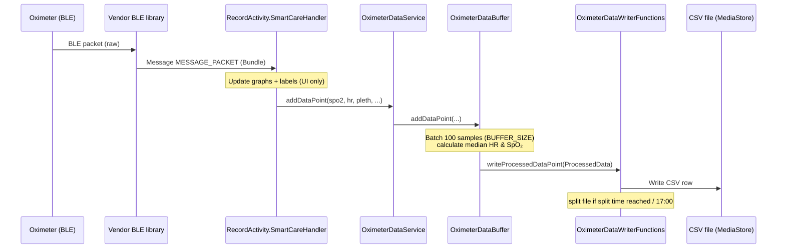
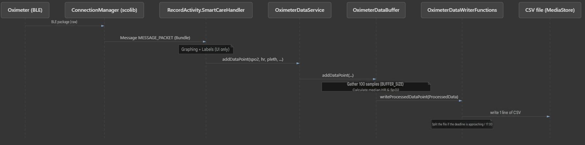
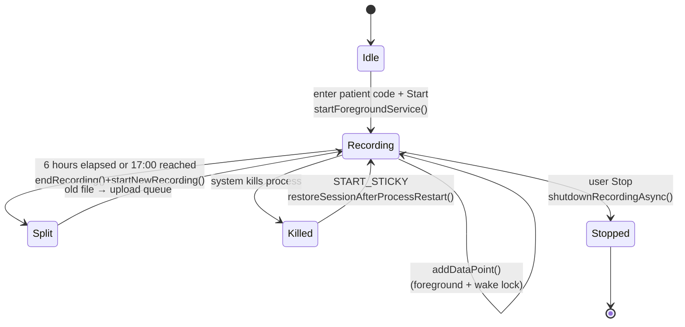

# Flow 03 — Data Recording

> **Tier 2 · Flow 3.** This is the **most critical flow**: a single sample goes from the oximeter → buffer (batches 100 samples) → CSV file, running in the background and preventing data loss.

---

## 1. One sample, device → file

---

## 2. Key points

1. **UI ≠ file writing.** `SmartCareHandler` updates the graphs (UI branch) and pushes the sample to `OximeterDataService` (recording branch) simultaneously. The Service is where the **actual writing** occurs, which is why recording continues when the UI is hidden.

2. **Batching 100 samples.** `OximeterDataBuffer` accumulates exactly **`BUFFER_SIZE = 100`** samples before emitting a single `ProcessedData` packet:
   - `hr` and `o2` (SpO₂) = **median** of the 100 samples (to smooth out noise).
   - `pleth`, `red`, `ir`, `perfusion` = **full array** of each individual sample (no median applied).
   - `timestamp` = the timestamp of the **middle** sample in the batch.
   - Purpose of batching: Reduce disk I/O operations and smooth out noise.

3. **Incomplete batches are not lost.** When stopping, splitting, or when BLE drops, `flushRemaining()` flushes the remaining (< 100) samples to the CSV.

4. **Writing via MediaStore.** `OximeterDataWriterFunctions` writes to the `Download/OximeterData/` directory. CSV columns:
   `timestamp, device_id, battery, hr, o2, spo2_status, pleth, red, ir, perfusion`.
   File name format: `SmartCareCsv_{patientCode}_{startStamp}_{endStamp}.csv` (the currently writing file uses `unknown` as the end timestamp until it is closed).

---

## 3. File splitting

The app **splits long sessions into multiple small CSV files** to limit the impact of potential errors:

| Trigger | Method | Condition |
|---|---|---|
| Hour cycle limit | `writeProcessedDataPoint()` → `splitFileLocked()` | `now >= nextSplitTime` and segment duration ≥ `MIN_SEGMENT_MS` (60s). Default cycle is **6 hours** (`SPLIT_INTERVAL_HOURS`). |
| BLE drop | `splitFileOnBlePause()` | Closes/finalizes the current segment if duration ≥ `MIN_SEGMENT_MS` (60s); does **not** reopen. Next CSV opens lazily via `ensureRecordingActive` / `startDataCollection` on the first packet after reconnect. |
| Daily 17:00 cutoff | `splitForDailyCutoff()` | Background scheduler broadcasts `ACTION_SPLIT_RECORDING`. |
| Start new session | `startNewRecording()` | Closes the old segment, cleans up orphaned `_unknown` files. |
| Stop | `endRecording()` | Closes the writer, renames the file with the actual end timestamp, returns the URI. |

---

## 4. Background recording

- **`OximeterDataService`** is a foreground service (type `CONNECTED_DEVICE` on API 29+) holding a **partial wake lock** (`"OximeterDataService::WakeLock"`) to keep the CPU awake when the screen is off.
- **Lazy CSV open (emphasized):** the service **does not open a file** on service bind/arm. No CSV exists until the **first sample** arrives (`addDataPoint` → `ensureRecordingActive` / `startDataCollection`). This avoids empty header-only CSVs when no device is connected, and matches BLE-pause behavior (close-only, no empty reopen).
- **Duration estimate (File Manager):** UI duration uses `size / BYTES_PER_RECORDING_HOUR` where `BYTES_PER_RECORDING_HOUR = 10 MiB` ≈ 1 hour of recording (see [flow-06](flow-06-file-management.md)).

---

## 5. Resilience

| Mechanism | Description |
|---|---|
| **`START_STICKY` + `RecordingSessionPrefs`** | If the process is killed, the service restarts with `intent == null` → `restoreSessionAfterProcessRestart()` reloads the session state and resumes recording. |
| **`onTaskRemoved` keep-alive** | If the session is active, the service **does not stop** when the user swipes the app out of the Recents list (allowing BLE to reconnect). |
| **Time-based file splitting** | Potential data corruption only affects the current segment, not the entire session. |
| **Flush incomplete batches** | `flushBufferedData()` / `flushRemaining()` pushes the remaining samples (< 100) before closing the writer. |
| **Throttled drop logging** | If samples are dropped (service not ready), warnings are logged at most once every 10s. |

---

## 6. Where to read the code

| Task | File · method |
|---|---|
| Receive packet & extract data | `RecordActivity.SmartCareHandler.handleMessage()` (`MESSAGE_PACKET`) |
| Push samples to service | `OximeterDataService.addDataPoint(...)` |
| Accumulate 100 samples + median | `OximeterDataBuffer.addDataPoint()`, `flushRemaining()`, `calculateMedian()` |
| Write CSV + split file | `OximeterDataWriterFunctions.writeProcessedDataPoint()`, `startNewRecording()`, `endRecording()`, `splitFileOnBlePause()` |
| Background execution/wake lock | `OximeterDataService.onStartCommand()`, `acquireWakeLock()`, `onTaskRemoved()` |
| Recover after process termination | `OximeterDataService.restoreSessionAfterProcessRestart()`, `RecordingSessionPrefs` |
| Constants (split interval, min segment, bytes/hour) | `RecordingConstants` (`SPLIT_INTERVAL_HOURS`, `MIN_SEGMENT_MS`, `BYTES_PER_RECORDING_HOUR`) |

---

## 7. Tweak points

| To change... | Modify |
|---|---|
| Batch size / median window | `OximeterDataBuffer.BUFFER_SIZE` |
| File split interval | `RecordingConstants.SPLIT_INTERVAL_HOURS` |
| CSV columns/format | `OximeterDataWriterFunctions` (header + `writeProcessedDataPoint`) |
| Add new data fields from device | `OximeterDataPacket` → `RecordActivity` (parse Message) → `OximeterDataService.addDataPoint` → `OximeterDataBuffer` → `OximeterDataWriterFunctions` |

---

## 8. Related

- [flow-02 — Bluetooth connection](flow-02-bluetooth-connection.md) · [flow-05 — File upload](flow-05-file-upload.md)
- Tier 3: [Data/Storage module](../3-modules/module-data-storage.md), [Device/Bluetooth module](../3-modules/module-device-bluetooth.md)
- Tier 4: [Data/Storage functions](../4-functions/functions-data-storage.md)
