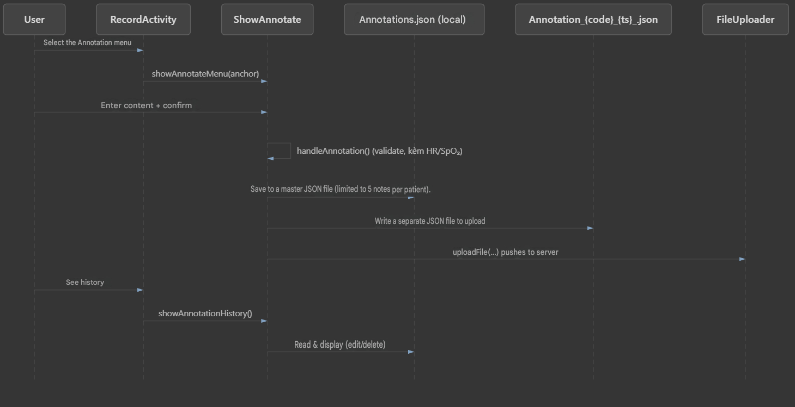

# Flow 04 — Annotation

> **Tier 2 · Flow 4.** How clinical staff add clinical notes during measurements, how the app saves JSON locally, and how they are uploaded.

---

## 1. Summary

- During a recording session, users can open the **Add Note** menu (`ShowAnnotate`) to enter structured clinical notes (date, PPG/ECG status, acquisition state, reason, etc.).
- Each note is saved into a local **master JSON file** and a **separate JSON file** for upload, appending the current HR/SpO₂.
- **`AnnotationStorage`** is the MediaStore helper for the master file at `Download/OximeterData/Annotation/Annotations.json` and for export `Annotation_*.json` under `Download/OximeterData/`.
- Master store keeps at most **5 notes per patient** (oldest dropped when exceeded).
- An **annotation history** screen (`AnnotationHistory`) allows viewing, editing, and deleting notes by patient code.

> Note on naming: despite being named "annotation", **`AnnotationHistory` only manipulates local JSON files**, it is not part of the HTTP upload layer.
> The background tasks named `UploadAnnotationWorker`/`AnnotationUploadScheduler` are actually part of the **general 17:00 upload scheduler** (see [flow-05](flow-05-file-upload.md)).

---

## 2. Sequence diagram

```mermaid
sequenceDiagram
    participant U as User
    participant RA as RecordActivity
    participant SA as ShowAnnotate
    participant STOR as AnnotationStorage
    participant JSON as Annotations.json (master)
    participant EXP as Annotation_{code}_{ts}_.json
    participant UP as FileUploader

    U->>RA: Select Annotation menu
    RA->>SA: showAnnotateMenu(anchor)
    U->>SA: Enter content + confirm
    SA->>SA: handleAnnotation() (validate, attaches HR/SpO₂)
    SA->>STOR: ensureMasterEntry / writeText (max 5 notes/patient; oldest dropped)
    STOR->>JSON: Save master JSON
    SA->>STOR: createEntry + writeText (export)
    STOR->>EXP: Write separate JSON file for upload
    SA->>UP: uploadFile(...) pushes to server
    U->>RA: View history
    RA->>SA: showAnnotationHistory()
    SA->>STOR: readText(master)
    STOR->>JSON: Read & display (edit/delete)
```



---

## 3. Step by step

1. **Open menu:** `RecordActivity` (Annotation menu) → `ShowAnnotate.showAnnotateMenu(anchorView)`. The dialog provides validation and displays fields conditionally based on selections.
2. **Save:** `handleAnnotation()` (private) loads/writes the master JSON via **`AnnotationStorage`**, **limiting annotations to 5 per patient** (oldest dropped), and attaches the latest `annotationHeartRate`/`annotationSpO2` (vitals values at the time of the note).
3. **Export for upload:** `AnnotationStorage.createEntry` writes `Annotation_{code}_{timestamp}_.json` under `Download/OximeterData`, then uploads it via `FileUploader`.
4. **View history:** `AnnotationHistory.showAnnotationHistory(context, patientCode)` displays a table filtered by patient code, ordered from newest to oldest; clicking a row triggers edit/delete dialogs.

**Model `AnnotationEntry`:** `timestamp`, `patientCode`, `note`, `heartRate`, `spO2`.

**`AnnotationStorage`:** MediaStore helper — master at `Download/OximeterData/Annotation/Annotations.json`; exports at `Download/OximeterData/Annotation_*.json`.

---

## 4. Where to read the code

| Task | File · method |
|---|---|
| Show add-note dialog | `ShowAnnotate.showAnnotateMenu(View)` |
| Save/validate note | `ShowAnnotate.handleAnnotation()` (private) |
| MediaStore read/write (master + export) | `AnnotationStorage.ensureMasterEntry()`, `createEntry()`, `readText()`, `writeText()` |
| Edit/delete note | `ShowAnnotate.updateAnnotation()/deleteAnnotation()`; `AnnotationHistory` |
| View history | `AnnotationHistory.showAnnotationHistory()` |
| Vitals used in notes | `RecordActivity.annotationHeartRate`, `annotationSpO2` |

---

## 5. Technical notes

- The vitals variables `annotationHeartRate`/`annotationSpO2` are currently implemented as **static variables** in `RecordActivity` (see "known issues" in the [documentation home](../index.md#known-issues--technical-debt)) — this could potentially cause stale values between sessions; exercise caution when refactoring.

---

## 6. Related

- [flow-05 — File upload](flow-05-file-upload.md) (annotations also utilize this upload channel)
- Tier 3: [UI/Recording module](../3-modules/module-ui-recording.md), [Network/Upload module](../3-modules/module-network-upload.md)
