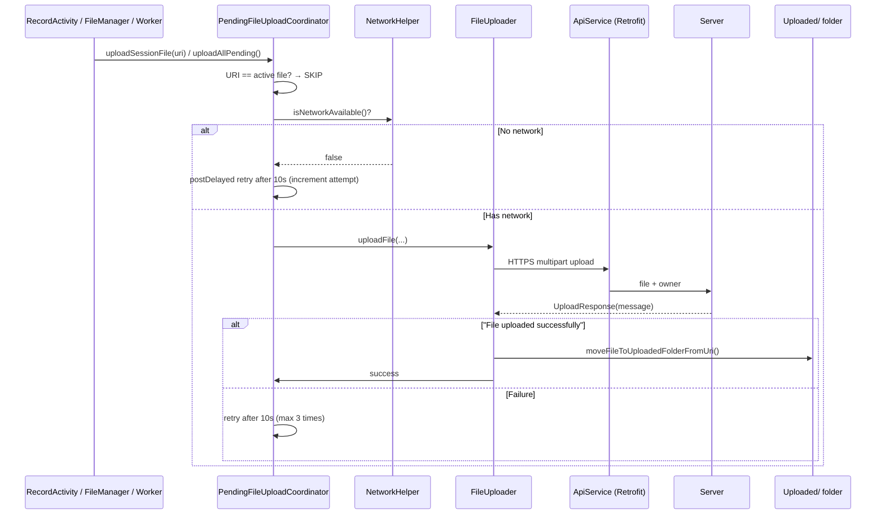
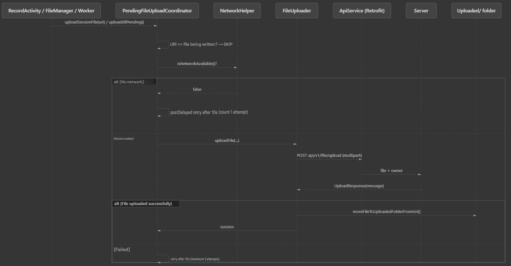
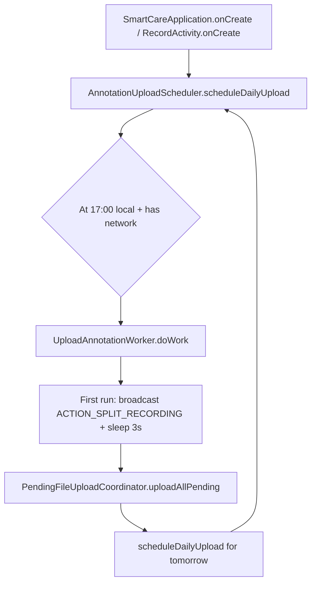

# Flow 05 — File Upload

> **Tier 2 · Flow 5.** How CSV files/annotations are queued, uploaded with retries, and moved to the `Uploaded/` folder.

---

## 1. Four upload paths

Three CSV/annotation paths route through **`PendingFileUploadCoordinator`** (up to **3 retries**, checks network state):

1. **Automatic post-close** — when a file is closed due to a split or session stop, the closed file is pushed to the queue (`RecordActivity` calls `uploadSessionFile`).
2. **Manual** — from `FileManagerActivity`, the user selects files to manually re-upload.
3. **Daily at 17:00** — `AnnotationUploadScheduler` schedules the WorkManager task `UploadAnnotationWorker` to run at **17:00** local time to upload remaining pending files (`uploadAllPending`).

A fourth path **bypasses** the coordinator (no move-to-`Uploaded/` for logs):

4. **Bug report** — `BugReportDialog` appends a `USER` / `BUG_REPORT` entry to selected daily log files, then calls `FileUploader.uploadFile` **sequentially** with a custom server name `SmartCareLog_{patient}_{dd.MM.yyyy.HH.mm.ss}_.txt` (date from the log day, time = upload moment; `_1` / `_2` on name collision). Logs stay in `{externalFilesDir}/Logs/`.

---

## 2. Sequence diagram — single upload attempt

---

## 3. Retry & safety policy

> The code locations referenced below point to **method names** in `PendingFileUploadCoordinator.java` (line numbers are omitted as code evolves).

| Parameter | Value | Behavior (and code implementation) |
|---|---|---|
| `MAX_ATTEMPTS` | **3** | Tracked per URI; skip if exceeds 3 failures → clear counter. → Declared as class constant; executed in `uploadWithRetry()`. |
| `RETRY_DELAY_MS` | **10,000 ms** | Network/upload failure → `Handler.postDelayed` retry after 10s. → Declared as class constant; used in `scheduleRetry()`. |
| In-flight guard | `IN_FLIGHT` set | Same URI not uploaded in parallel. → Checked/added/removed in `uploadWithRetry()` (and removed in `onUploadComplete()` callback). |
| **Open-file guard** | against `getCurrentOpenFileUriString()` | **Never** upload active recording file (avoids writer corruption). → Single path check in `uploadSessionFile()`; batch path check in `shouldSkipPendingEntry()`. |
| Network check | `NetworkHelper.isNetworkAvailable()` | No network → schedule retry (counts as an attempt). → in `uploadWithRetry()`. |
| Skip empty files | `shouldSkipPendingEntry()` | Skip 0-byte `*_unknown` files; allow non-empty unknown files (recovery from crash). → `shouldSkipPendingEntry()`. |
| Success handler | `moveFileToUploadedFolderFromUri()` | Move to `Download/OximeterData/Uploaded` + `AppRecordingRegistry.markUploaded()`. → callback `onUploadComplete()` (on success) calls `moveFileToUploadedFolderFromUri()`. |

> **Configuration Note:** `NetworkConfig.MAX_RETRY=3` and `RETRY_DELAY_MS=10000` are purely for **documentation/reference**; the actual retry logic is implemented locally inside `PendingFileUploadCoordinator`. `FileUploader` **does not retry** on its own (single attempt) — retries are managed by the coordinator.

---

## 4. Daily 17:00 schedule

- Uses a self-chaining `OneTimeWorkRequest` (not `PeriodicWorkRequest`), named `smartcare_daily_17h_maintenance`, using `ExistingWorkPolicy.REPLACE` with a `NetworkType.CONNECTED` constraint.
- The first run of the day (`getRunAttemptCount() == 0`) will **split the currently recording file** first, and then upload; subsequent internal retries of WorkManager bypass the splitting step.

---

## 5. Server configuration (public)

Upload uses **HTTPS multipart** requests configured at **build time** (base URL, timeouts, success message strings). Exact paths, owner fields, and authentication are **internal deployment documentation** — see [Tier 1 — Configuration & deployment](../1-overview/PROJECT-OVERVIEW.md#configuration--deployment).

At runtime, `RetrofitClient` applies timeouts from `NetworkConfig`; `FileUploader` treats specific success messages in the JSON response as completion before moving files to `Uploaded/`.

---

## 6. Where to read the code

| Task | File · method |
|---|---|
| Coordinate uploads + retries | `PendingFileUploadCoordinator.uploadSessionFile()`, `uploadAllPending()` |
| Perform HTTP upload | `FileUploader.uploadFile()`, `moveFileToUploadedFolderFromUri()` |
| Bug-report log upload | `BugReportDialog.show()` → `FileLogger.appendUserReportToFile()` → sequential `FileUploader.uploadFile(...)` |
| HTTP client & upload contract | `network/ApiService`, `network/RetrofitClient`, `network/UploadResponse` |
| Check network state | `NetworkHelper.isNetworkAvailable()` |
| Daily 17:00 schedule | `AnnotationUploadScheduler.scheduleDailyUpload()`, `UploadAnnotationWorker.doWork()` |
| Build-time URL/timeouts | `config/ApiConfig`, `config/NetworkConfig` (values internal) |

---

## 7. Related

- [flow-03 — Data recording](flow-03-data-recording.md) · [flow-06 — File management](flow-06-file-management.md)
- Tier 3: [Network/Upload module](../3-modules/module-network-upload.md)
