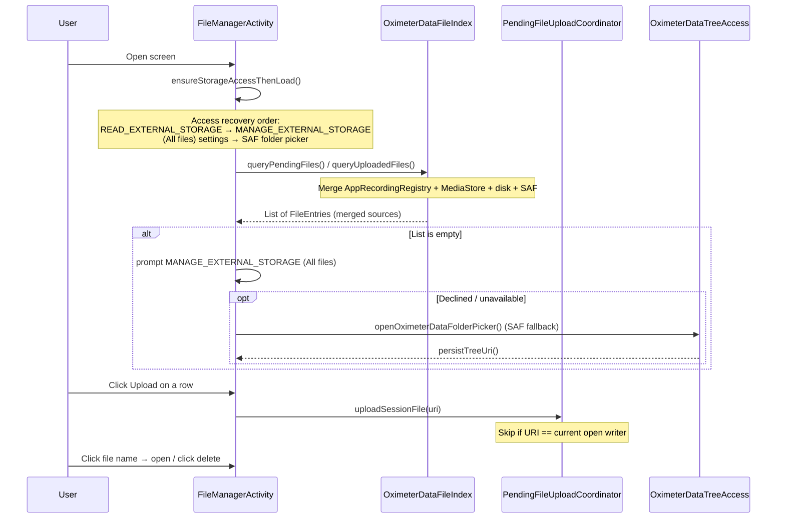
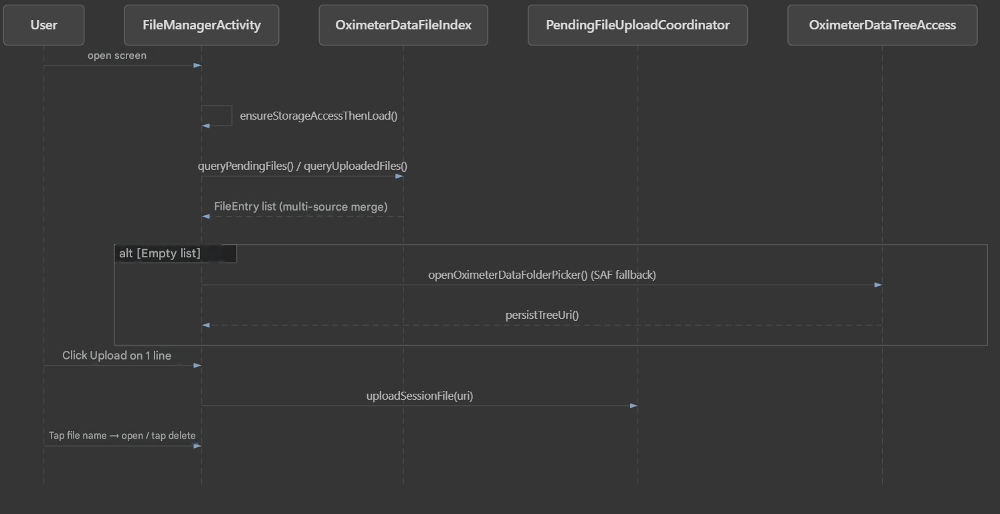

# Flow 06 — File Management

> **Tier 2 · Flow 6.** The `FileManagerActivity` screen browses recorded files (pending) and uploaded files (uploaded), handles manual uploads, and performs open/delete actions, along with fallback mechanisms to list files on strict devices.

---

## 1. Summary

- `FileManagerActivity` consists of **2 tabs**: **Pending** (not yet uploaded) and **Uploaded** (successfully uploaded), reading from the `Download/OximeterData` directory.
- The file list is aggregated from **multiple sources** via `OximeterDataFileIndex` (merging `AppRecordingRegistry` + MediaStore + disk + SAF) to ensure no files are missed on devices where MediaStore returns incomplete results (especially Samsung devices and over MTP).
- A MediaStore **observer** tracks real-time file updates while recording is active.
- **CSV duration estimate** in the UI: `sizeBytes / BYTES_PER_RECORDING_HOUR` where `BYTES_PER_RECORDING_HOUR = 10 MiB` ≈ 1 hour.
- Upload from this screen **skips the currently open writer URI** (same open-file guard as the coordinator).

---

## 2. Sequence diagram

---

## 3. Where the file list comes from

`OximeterDataFileIndex` **merges** several data sources to compile the final file list:
- `AppRecordingRegistry` (a registry of recorded file URIs — acts as a fallback when MediaStore lacks `RELATIVE_PATH`).
- MediaStore Downloads + MediaStore Files volumes.
- Direct disk scanning (`Download/OximeterData`, including the misspelled `OximetaData` folder).
- Storage Access Framework (SAF) document tree (`OximeterDataTreeAccess`) if the user has granted directory access.

Only files that belong to the application are listed: `SmartCareCsv*.csv` or `Annotation_*.json` (excluding the master `Annotations.json` file).

### Access recovery order
When the pending list is empty / disk listing is incomplete, File Manager escalates in this order:
1. Request **`READ_EXTERNAL_STORAGE`** (API 29–32) via `ensureStorageAccessThenLoad()`.
2. Prompt **`MANAGE_EXTERNAL_STORAGE`** (All files access) settings on API 30+.
3. Fall back to the **SAF folder picker** (`OximeterDataTreeAccess` / `openOximeterDataFolderPicker()`).

### Duration estimate
For each CSV row, estimated duration = `sizeBytes / RecordingConstants.BYTES_PER_RECORDING_HOUR` (`10 MiB` ≈ 1 hour).

---

## 4. Operations

| Operation | Method |
|---|---|
| Reload file list (background) | `refreshFileLists()` / `refreshFileListsQuiet()` |
| Manually upload 1 file | Pending row → `PendingFileUploadCoordinator.uploadSessionFile()` (skips currently open writer URI) |
| Open file | `openCsvFile()` (via `ACTION_VIEW` + FileProvider/content URI) |
| Delete uploaded file | `deleteUploadedFile()` |
| Observe changes during recording | `MediaStore.Downloads` observer (registered in `onResume`, unregistered in `onPause`) |
| All-files access prompt | `showManageAllFilesAccessRationaleDialog()` → `openManageAllFilesAccessSettings()` |
| Directory permission fallback | `openOximeterDataFolderPicker()` (SAF `ACTION_OPEN_DOCUMENT_TREE`) |

---

## 5. Where to read the code

| Task | File · method |
|---|---|
| Screen lifecycle | `FileManagerActivity.onCreate/onResume/onPause/onDestroy` |
| List files (merged sources) | `OximeterDataFileIndex.queryPendingFiles()/queryUploadedFiles()` |
| List adapters | inner `CsvFileAdapter` (pending), `UploadedFileAdapter` (uploaded), `CsvFile` (wrapper) |
| SAF permissions | `OximeterDataTreeAccess.getPersistedTreeUri()/persistTreeUri()` |
| File registry | `AppRecordingRegistry` |

---

## 6. Related

- [flow-05 — File upload](flow-05-file-upload.md)
- Tier 3: [Data/Storage module](../3-modules/module-data-storage.md), [UI/Recording module](../3-modules/module-ui-recording.md)
