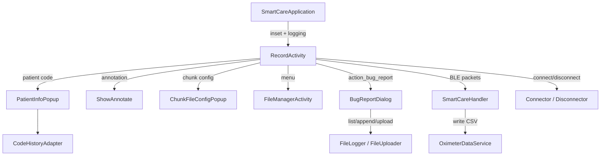
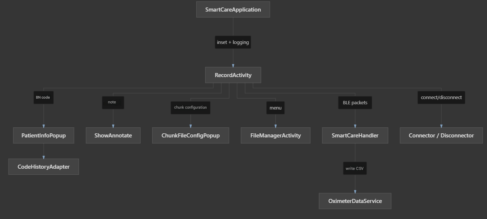

# Module — UI / Recording

> **Tier 3.** UI module: recording screen, file manager, popups, event annotation, adapters, and app initialization.
> For details on each function, see [Tier 4 — functions-ui-recording.md](../4-functions/functions-ui-recording.md).

**9 classes:** `RecordActivity`, `FileManagerActivity`, `ShowAnnotate`, `AnnotationHistory`*, `BugReportDialog`, `PatientInfoPopup`, `ChunkFileConfigPopup`, `CodeHistoryAdapter`, `SystemBarInsetsHelper`, `SmartCareApplication`.

> *`AnnotationHistory` is listed in detail under the [Network/Upload module](module-network-upload.md) based on analysis, but essentially belongs to the UI layer. It is treated as UI here since it only operates on local JSON files. Counted toward Network (12); UI tally = 9 without double-counting.

---

## 1. `RecordActivity`
`app/.../RecordActivity.java` — **The primary screen** (~2600 lines). Connects to the BLE oximeter, displays real-time PPG waves, HR, SpO₂, and battery, pushes samples to `OximeterDataService` for CSV writing, manages BLE scans/reconnects, gates patient codes, and controls session life cycles (splitting CSV on BLE pause vs. stopping sessions entirely).

- **Notable Static States:** `MacAddress` (active connected MAC), `isRecordingSessionActive` (app-wide session active state), `annotationHeartRate`/`annotationSpO2` (latest vitals used for annotations).
- **Function Groups:**
  - **Lifecycle:** `onCreate`, `onStop`, `onDestroy`, option menu callbacks (`onCreateOptionsMenu`, `onOptionsItemSelected` — routes include `action_bug_report` → `BugReportDialog`).
  - **Permissions:** `checkAppPermissions`, `onRequestPermissionsResult`, `requestBluetoothPermissions`.
  - **Connection/Session:** `connectToPulseOximeter`, `ensureServiceAndConnect`, `stopDisconnectExit`, `persistRecordingSessionState`, `splitCsvOnBlePause`, `restoreRecordingSessionFromPrefsIfNeeded`, `reconnectToService`.
  - **UI:** `initialiseViews`, `initialisePlot`, `togglePlotVisibility`, `checkAndRequestPatientCode`.
  - **BLE Scanning:** `initializeBluetoothScanning`, `startBluetoothBackgroundScan`, `scheduleAutoReconnect`, `showConnectedDevicesPopup`.
- **Inner Classes:** `SmartCareHandler` (receives Messages from the vendor library — see [flow-02](../2-architecture/flow-02-bluetooth-connection.md#3-device-handler-messages)), `Connector`/`Disconnector` (AsyncTask for connection/disconnection), `serviceConnection` (binds the background service).

---

## 2. `FileManagerActivity`
`app/.../FileManagerActivity.java` — Two-tab file browser (**pending** / **uploaded**) reading from `Download/OximeterData`. Handles storage permissions, SAF fallback, MediaStore observer (live updates during recording), manual uploads, and open/delete actions.

- **Function Groups:** lifecycle (`onCreate/onResume/onPause/onDestroy/onActivityResult`), files (`refreshFileLists`, `openCsvFile`, `deleteUploadedFile`), storage (`ensureStorageAccessThenLoad`, `openOximeterDataFolderPicker`).
- **Inner Classes:** `CsvFileAdapter` (pending), `UploadedFileAdapter` (uploaded), `CsvFile` (wrapper around `FileEntry`).
- Detailed flow: [flow-06](../2-architecture/flow-06-file-management.md).

---

## 3. `ShowAnnotate`
`app/.../ShowAnnotate.java` — Collects clinical notes during measurements. Displays a structured dialog, saves notes in `Annotations.json`, exports individual JSON notes for upload, and appends current HR/SpO₂.
- **Primary Methods:** `showAnnotateMenu`, `showAnnotationHistory`, `updateAnnotation`, `deleteAnnotation`.
- **Inner Class:** `AnnotationEntry` (model: timestamp, patientCode, note, heartRate, spO2). Details: [flow-04](../2-architecture/flow-04-annotation.md).

---

## 4. `BugReportDialog`
`app/.../BugReportDialog.java` — Menu **Report** dialog: multi-select daily log files (`FileLogger.listAvailableLogFiles()`; **today** pre-checked), requires a non-empty description and network, appends the user report into each selected log via `FileLogger.appendUserReportToFile`, then uploads sequentially through `FileUploader` as `SmartCareLog_{patient}_{timestamp}_.txt` (timestamp from `FileLogger.formatBugReportUploadTimestamp`).
- **Primary Methods:** `show`, `sendReport`, `resolveBugReportUploadNames`, `uploadFilesSequentially`.
- **Entry:** `RecordActivity.onOptionsItemSelected` → `R.id.action_bug_report`.
- Consumes Network helpers: see [module-network-upload.md](module-network-upload.md) (`FileLogger`, `FileUploader`, `NetworkHelper`).

---

## 5. `PatientInfoPopup`
`app/.../PatientInfoPopup.java` — Popup for inputting/selecting the **research code** (along with location/serial). Persists in `PatientInfoPrefs`, keeps up to 5 recent codes, and **locks the app** until a valid code is entered on launch.
- **Primary Methods:** `show`, `setCancelable`, `setOnPatientInfoSavedListener`, `isCodeSaved`, `clearSavedCode`, `getSavedPatientInfo`.
- **Inner Classes:** `OnPatientInfoSavedListener`, `PatientInfo` (researchCode/locationCode/serialNumber), `TextChangeListener`.

---

## 6. `ChunkFileConfigPopup`
`app/.../ChunkFileConfigPopup.java` — Configuration popup to toggle and set the splitting interval for StreamModel chunk files. Persisted in `ChunkFileConfigPrefs`; values are forwarded to `OximeterDataService` upon connection.
- **Primary Methods:** `show`, `isChunkFileEnabled` (default false), `getTimeInterval` (default 3 minutes).

---

## 7. `CodeHistoryAdapter`
`app/.../CodeHistoryAdapter.java` — RecyclerView adapter for the list of recent patient codes in `PatientInfoPopup`. Supports click-to-fill and row removal.
- **Primary Methods:** `onCreateViewHolder`, `onBindViewHolder`, `updateCodes`, `removeCode`.
- **Inner Classes/Interfaces:** `OnCodeClickListener`, `OnCodeDeleteListener`, `CodeViewHolder`.

---

## 8. `SystemBarInsetsHelper`
`app/.../SystemBarInsetsHelper.java` — Utility layout padder based on status bar / navigation bar / cutout to prevent UI obstruction.
- **Methods:** `static apply(Activity)`. Called from `SmartCareApplication.onActivityPostCreated`.

---

## 9. `SmartCareApplication`
`app/.../SmartCareApplication.java` — Application singleton. Initializes `FileLogger`, `FileUploader`, global crash handler, activity lifecycle logs, tracks foreground/background state, applies system bar insets, configures the daily 17:00 upload schedule, and diagnostics for low-memory events.
- **Primary Methods:** `onCreate`, `onTrimMemory`, `onLowMemory`, `installCrashHandler` (private).
- Details: [flow-01](../2-architecture/flow-01-app-startup.md).

---

## Interaction Diagram

