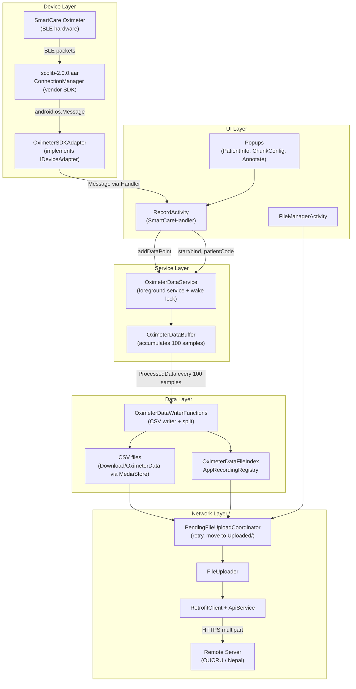

# Tier 2 — Architecture Overview

> **Goal:** Explain **how the system operates** at a high level, then guide you to each detailed **flow**.
> This is **Tier 2**. If you have not read [Tier 1 — Project Overview](../1-overview/PROJECT-OVERVIEW.md), please read it first.

---

## 1. The 5 layers

The app is divided into **5 layers**, with data flowing from device → UI/Service → file → server.

---

## 2. Responsibility per layer

| Layer | Primary Files | Responsibility |
|---|---|---|
| **Device** | `device/OximeterSDKAdapter`, `device/IDeviceAdapter`, `device/OximeterDataPacket`, `device/OximeterDataListener` | Isolates the manufacturer's SDK (`scolib-2.0.0.aar`); translates SDK callbacks into standardized app data. |
| **UI** | `RecordActivity`, `FileManagerActivity`, `PatientInfoPopup`, `ChunkFileConfigPopup`, `ShowAnnotate`, `AnnotationHistory` | Renders PPG/HR/SpO₂/battery waves; inputs patient codes; controls start/stop; manages & uploads files manually. |
| **Service** | `OximeterDataService`, `OximeterDataBuffer`, `RecordingSessionPrefs`, `RecordingConstants` | Runs continuously in the background (foreground service + wake lock); batches data; survives process termination. |
| **Data** | `OximeterDataWriterFunctions`, `OximeterDataFileIndex`, `AppRecordingRegistry`, `OximeterDataTreeAccess` | Writes CSV via MediaStore; splits files periodically; tracks file state (pending/uploaded). |
| **Network** | `PendingFileUploadCoordinator`, `FileUploader`, `network/RetrofitClient`, `network/ApiService`, `config/ApiConfig`, `config/NetworkConfig` | Uploads CSV (multipart) with retries; moves uploaded files to `Uploaded/`; configures URL/token/timeout. |
| **App** | `SmartCareApplication`, `FileLogger`, `MemoryDiagnostics`, `AnnotationUploadScheduler`, `UploadAnnotationWorker` | Initializes logging + crash handler; schedules daily cleanup/upload at 17:00. |

> For detailed class definitions by module, see **Tier 3** — [`MODULES-INDEX.md`](../3-modules/MODULES-INDEX.md).

---

## 3. Two key design principles

### 3.1. UI and file writing are TWO separate branches

`RecordActivity` (Activity) is only responsible for **rendering graphs**. The **actual data recording** is handled by `OximeterDataService` (background service).
Thanks to this decoupling, the app **continues to record even when the UI is hidden** (screen turned off, app put in background).

### 3.2. Isolating the manufacturer's SDK behind an Adapter

The manufacturer's SDK (`ConnectionManager` in `scolib-2.0.0.aar`) is accessed only through `OximeterSDKAdapter` (which implements `IDeviceAdapter`).
When changing hardware or SDKs, **only the adapter file needs to be modified**, leaving `RecordActivity` untouched.
See the 3-step guide in [flow-02-bluetooth-connection.md](flow-02-bluetooth-connection.md#5-swapping-the-device-sdk).

---

## 4. The flows

Each flow is described in its own file, complete with sequence/state diagrams and code references:

| # | Flow | File | Summary |
|---|---|---|---|
| 1 | **App startup** | [flow-01-app-startup.md](flow-01-app-startup.md) | App launches, initializes logging/crash handler, forces patient code input, restores sessions if any. |
| 2 | **Bluetooth connection** | [flow-02-bluetooth-connection.md](flow-02-bluetooth-connection.md) | Scan, connect, auto-reconnect, filter unexpected BLE events, swap hardware SDKs. |
| 3 | **Data recording** | [flow-03-data-recording.md](flow-03-data-recording.md) | A single sample flows from device → buffer (batches 100) → CSV; file splitting; background execution. |
| 4 | **Annotation** | [flow-04-annotation.md](flow-04-annotation.md) | Create/edit/delete notes, save JSON, upload. |
| 5 | **File upload** | [flow-05-file-upload.md](flow-05-file-upload.md) | Upload queue, 3-try retry mechanism, moving to `Uploaded/`, 17:00 daily scheduler. |
| 6 | **File management** | [flow-06-file-management.md](flow-06-file-management.md) | Browse pending/uploaded files, manual upload, open/delete files, SAF fallback. |

---

## 5. Resilience at a glance

This is why the architecture may seem complex. The main mechanisms (detailed in each flow) include:

- **Foreground service + wake lock** → continue recording when the screen is off.
- **`START_STICKY` + `RecordingSessionPrefs`** → if the system kills the process, the service automatically restarts and **continues** the previous session.
- **Time-based CSV splitting** → a crash or error only corrupts a small segment, not the entire session.
- **`onTaskRemoved` keeps the service alive** when the user swipes the app out of Recents (allowing BLE to reconnect).
- **Crash handler** writes crash logs to a file before the app terminates.
- **Upload never touches the currently active file** → avoiding writer corruption.

---

## 6. Configuration

All environment values are loaded from `local.properties` → `BuildConfig` → `ApiConfig`/`NetworkConfig`. No values are hardcoded.
For details, see [Tier 1 Section 8](../1-overview/PROJECT-OVERVIEW.md#8-configuration--server).

---

*Keep this updated when the architecture changes.*
