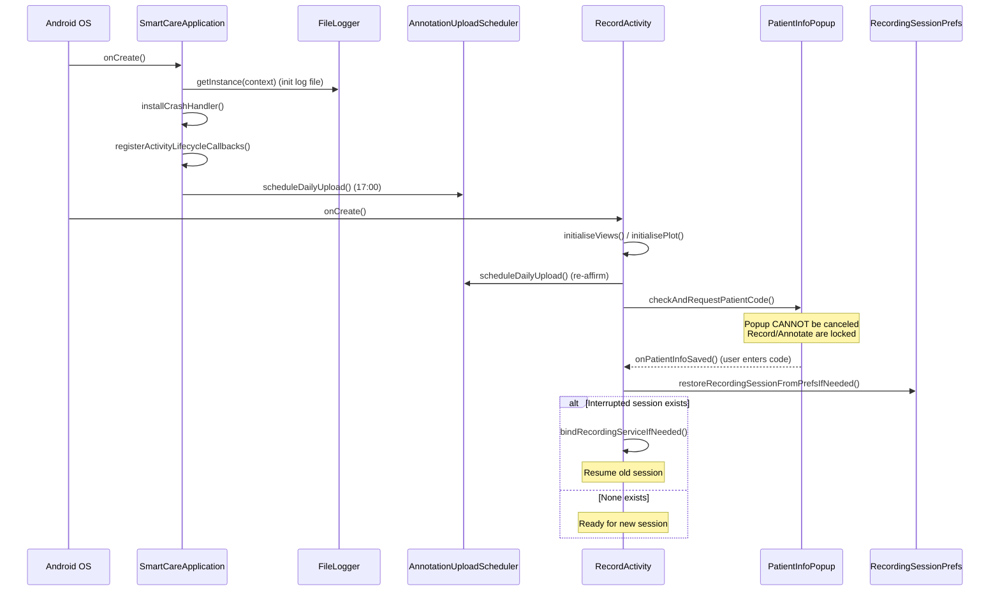
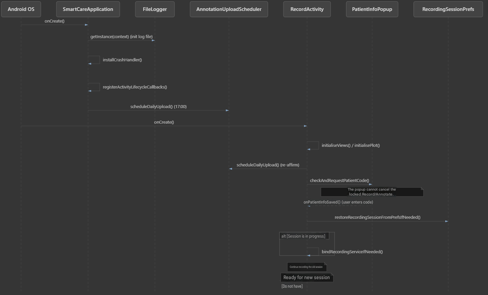

# Flow 01 — App Startup

> **Tier 2 · Flow 1.** App launches → initializes infrastructure (logging, crash handler, upload scheduler) → forces patient code input → restores recording session if previously interrupted.

---

## 1. Summary

When the app opens, two components initialize in order:

1. **`SmartCareApplication.onCreate()`** — runs **once per process**, building the background infrastructure.
2. **`RecordActivity.onCreate()`** — runs every time the recording screen opens, building the UI and forcing patient code entry.

---

## 2. Sequence diagram

---

## 3. Step by step

### Step 1 — `SmartCareApplication.onCreate()`
- Initializes **`FileLogger`** (writes logs to `{externalFilesDir}/Logs/smartcare_app_log.txt`).
- Calls **`FileUploader.setAppContext()`** to enable background uploading.
- **`installCrashHandler()`** — wraps the default uncaught-exception handler to **flush crash logs to the file** before the app terminates.
- Registers **`ActivityLifecycleCallbacks`** to: apply system bar insets (`SystemBarInsetsHelper`), log foreground/background transitions, and log lifecycles of each activity.
- **`AnnotationUploadScheduler.scheduleDailyUpload()`** — schedules the 17:00 background task (see [flow-05](flow-05-file-upload.md)).

### Step 2 — `RecordActivity.onCreate()`
- `initialiseViews()`, `initialisePlot()`, `initialiseSeries()` — builds UI and AndroidPlot graphs.
- Creates `OximeterSDKAdapter` + `BluetoothEventInterceptor` (see [flow-02](flow-02-bluetooth-connection.md)).
- `checkAndRequestPatientCode()` — displays a **non-cancellable** `PatientInfoPopup`, **locking** the Record/Annotate buttons until a valid **research code** is entered.

### Step 3 — Session restore
- After obtaining the patient code: `restoreRecordingSessionFromPrefsIfNeeded()` reads `RecordingSessionPrefs`.
- If an active session exists and **matches the patient code** → `bindRecordingServiceIfNeeded()` to **resume recording** (instead of creating a new session).
- This is a key link in the data loss prevention mechanism (see [flow-03 section 5](flow-03-data-recording.md#5-resilience)).

---

## 4. Where to read the code

| Task | File · method |
|---|---|
| Initialize process infrastructure | `SmartCareApplication.onCreate()` |
| Install crash handler | `SmartCareApplication.installCrashHandler()` |
| Apply system bar insets | `SystemBarInsetsHelper.apply(activity)` |
| Build recording screen UI | `RecordActivity.onCreate()` → `initialiseViews()` |
| Force patient code entry | `RecordActivity.checkAndRequestPatientCode()` + `PatientInfoPopup.show()` |
| Restore session | `RecordActivity.restoreRecordingSessionFromPrefsIfNeeded()`, `RecordingSessionPrefs.load()` |

---

## 5. Related

- [flow-02 — Bluetooth connection](flow-02-bluetooth-connection.md)
- [flow-03 — Data recording](flow-03-data-recording.md)
- Tier 3: [UI/Recording module](../3-modules/module-ui-recording.md), [Network/Upload module](../3-modules/module-network-upload.md)
