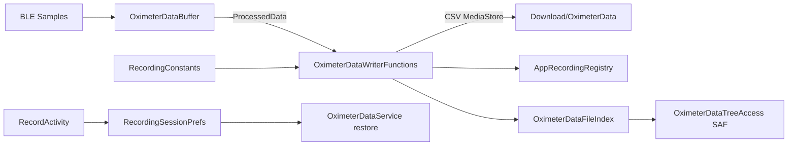
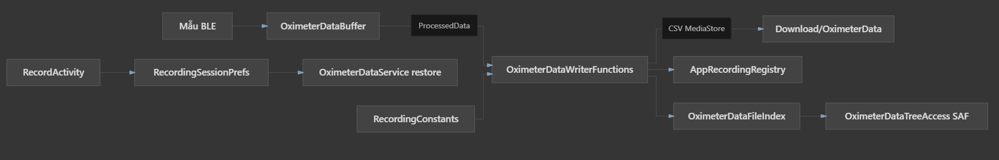

# Module — Data / Storage

> **Tier 3.** Data & storage module: sample batching, CSV writing, file indexing, session recovery, and RAM diagnostics.
> For details on each function, see [Tier 4 — functions-data-storage.md](../4-functions/functions-data-storage.md).

**8 classes:** `OximeterDataBuffer`, `OximeterDataWriterFunctions`, `OximeterDataFileIndex`, `OximeterDataTreeAccess`, `RecordingSessionPrefs`, `RecordingConstants`, `AppRecordingRegistry`, `MemoryDiagnostics`.

**Data Flow:** BLE samples → `OximeterDataBuffer` (batches 100) → `OximeterDataWriterFunctions` (CSV via MediaStore) → `OximeterDataFileIndex`/`AppRecordingRegistry`/`OximeterDataTreeAccess` (file listing); session state is persisted via `RecordingSessionPrefs`.

---

## 1. `OximeterDataBuffer`
`app/.../OximeterDataBuffer.java` — Thread-safe aggregator: batches raw samples into blocks of **100** (`BUFFER_SIZE`), calculates the median, and emits a CSV row/batch via `OximeterDataWriterFunctions.writeProcessedDataPoint`.

- Uses a `ConcurrentLinkedQueue` + an `AtomicBoolean isProcessing` flag (only one thread drains at a time).
- `hr`/`o2` = **median**; `pleth`/`red`/`ir`/`perfusion` = **full array** of each individual sample; timestamp = middle sample of the batch.
- Device battery is converted from 3300–4150 mV → 0–100% (rounded up).
- **Methods:** `addDataPoint(...)`, `flushRemaining()`.
- **Inner Classes:** `DataPoint` (raw, private), `ProcessedData` (representing a CSV row, public).

---

## 2. `OximeterDataWriterFunctions`
`app/.../OximeterDataWriterFunctions.java` — CSV session manager: creates files in MediaStore Downloads (`Download/OximeterData/`), writes headers and rows, **splits segments** based on time/BLE pause/17:00, renames `_unknown` files on close, and optionally records StreamModel chunk files.

- **CSV Columns:** `timestamp, device_id, battery, hr, o2, spo2_status, pleth, red, ir, perfusion`.
- **File Name:** `SmartCareCsv_{patientCode}_{startStamp}_{endStamp}.csv` (timestamp format: `dd.MM.yyyy.HH.mm.ss`; currently active segment uses `unknown` as end stamp).
- **Primary Methods:** `initialize`, `setSplitInterval`, `isRecordingActive`, `getCurrentOpenFileUriString`, `startNewRecording`, `writeProcessedDataPoint`, `splitFileOnBlePause`, `splitForDailyCutoff`, `endRecording`, `getOximeterDataPath`, `formatTimestamp`.
- All writer state is synchronized via `SPLIT_LOCK`. Details on splitting: [flow-03 section 3](../2-architecture/flow-03-data-recording.md#3-file-splitting).

---

## 3. `OximeterDataFileIndex`
`app/.../OximeterDataFileIndex.java` — Unified index of exported files (`SmartCareCsv*.csv`, `Annotation_*.json`) for the 2 File Manager tabs, **merging multiple sources**: direct disk scan, MediaStore Downloads + Files volumes, `AppRecordingRegistry`, and optional SAF tree.

- **Inner Class:** `FileEntry` (uri, displayName, sizeBytes, lastModifiedMs).
- **Primary Methods:** `isAppDataFileName`, `queryPendingFiles`, `queryUploadedFiles`, `refreshMediaStore(Deep)`, `tryDiskEntryByDisplayName`, `lookupDownloadEntry`, `notifyRecordingSaved`, `getPendingDirectory`, `getUploadedDirectory`.

---

## 4. `OximeterDataTreeAccess`
`app/.../OximeterDataTreeAccess.java` — Stores the SAF document tree URI (`ACTION_OPEN_DOCUMENT_TREE`) to list files when direct file access and MediaStore return empty results (common on Samsung devices and over MTP).
- **Methods:** `getPersistedTreeUri`, `persistTreeUri`, `clearPersistedTreeUri`.

---

## 5. `RecordingSessionPrefs`
`app/.../RecordingSessionPrefs.java` — Persists the active session state in SharedPreferences for `OximeterDataService`/`RecordActivity` to restore after process termination or a service restart (`START_STICKY`) without a new Intent.
- **Keys:** active, patientCode, chunkEnabled, chunkInterval, collectionStartMs.
- **Inner Class:** `Session`. **Methods:** `markActive`, `clear`, `isActive`, `load`.
- Recovery mechanism flow: [flow-03 section 5](../2-architecture/flow-03-data-recording.md#5-resilience).

---

## 6. `RecordingConstants`
`app/.../RecordingConstants.java` — Shared constants for 24h recording sessions:
| Constant | Value | Purpose |
|---|---|---|
| `SPLIT_INTERVAL_HOURS` | 6 | Interval (in hours) between automatic CSV splits |
| `SPLIT_INTERVAL_MS` | 21,600,000 | Same as above, in milliseconds |
| `MIN_SEGMENT_MS` | 60,000 (60s) | Minimum duration of a segment before it can be split |
> Note: `BUFFER_SIZE` (100) is defined in `OximeterDataBuffer`, not here.

---

## 7. `AppRecordingRegistry`
`app/.../AppRecordingRegistry.java` — Registry of recorded file URIs (saved as JSON in SharedPreferences) so the File Manager can list files when MediaStore lacks `RELATIVE_PATH` or is slow (common on Samsung tablets).
- **Methods:** `registerCompletedRecording`, `markUploaded`, `queryRegistryPending`.

---

## 8. `MemoryDiagnostics`
`app/.../MemoryDiagnostics.java` — Generates hardware RAM and JVM heap snapshots for `FileLogger` and lifecycle logging.
- **Methods:** `formatDeviceSummary`, `formatSnapshot`, `trimLevelName`.

---

## Interaction Diagram

