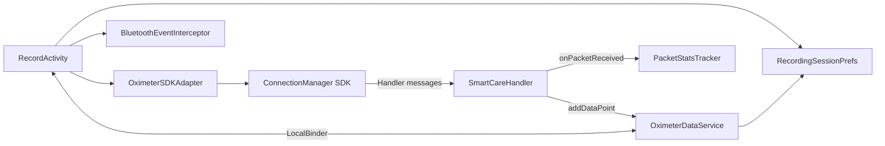
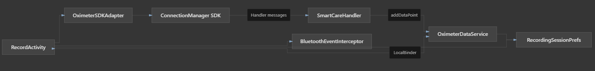

# Module — Device / Bluetooth

> **Tier 3.** Device & connectivity module: vendor SDK wrapper, background data recording service, and unexpected BLE event filtering.
> For details on each function, see [Tier 4 — functions-device-bluetooth.md](../4-functions/functions-device-bluetooth.md).

**8 classes:** `IDeviceAdapter`, `OximeterSDKAdapter`, `OximeterDataPacket`*, `OximeterDataListener`*, `OximeterDataService`, `BluetoothEventInterceptor`, `PacketStatsTracker`, `BluetoothAutoConnector`*.

> *`OximeterDataPacket`, `OximeterDataListener`, and `BluetoothAutoConnector` are **legacy — not used** in the current data flow (kept for reference).

**Principle:** `RecordActivity` owns the Bluetooth UX and links `OximeterSDKAdapter` (which wraps the SDK's `ConnectionManager`) to `OximeterDataService`. SDK events are reported back via **Handler messages** (`SmartCareHandler`), **not** through `OximeterDataListener`.

---

## 1. `IDeviceAdapter` (interface)
`app/.../device/IDeviceAdapter.java` — Abstraction of the oximeter connection lifecycle. `RecordActivity` holds an `IDeviceAdapter connectionManager` reference, with `OximeterSDKAdapter` as the sole concrete implementation.
- **Methods:** `connect()`, `connect(String mac)`, `disconnect()`, `isRecording()`, `getMacAddress()`, `getOximeterModelNumber()`, `getSampleRate()`, `startRecording()`, `onDestroy()`, `setListener()`.

---

## 2. `OximeterSDKAdapter` (implements IDeviceAdapter)
`app/.../device/OximeterSDKAdapter.java` — **The only file that needs modification when changing hardware.** A lightweight wrapper around `com.smartcare.oximetry.library.ConnectionManager` from **`scolib-2.3.0`**, delegating connect/disconnect/recording operations and passing a `Handler` (typically `RecordActivity.SmartCareHandler`) for the SDK to dispatch messages.

**Characteristics/Workarounds:**
- The constructor uses **reflection to bypass device name filtering** (obfuscated class `...library.a`, field `d` of type `String[]`, setting `names[0] = ""`) to match all devices → must review when upgrading `.aar`.
- `setListener()` is a **no-op** (data is routed via the Handler).
- `disconnect()` only executes when recording is active (avoiding redundant calls).

3-step guide to swap SDKs: [flow-02 section 5](../2-architecture/flow-02-bluetooth-connection.md#5-swapping-the-device-sdk).

---

## 3. `OximeterDataPacket` (POJO, legacy)
`app/.../device/OximeterDataPacket.java` — Value object representing a single sample (pleth, SpO₂, pulse, ADC, battery, etc.). Only referenced by the legacy `OximeterDataListener`; the active data flow parses `Bundle` from `ConnectionManager` directly, making this class **unused**.

---

## 4. `OximeterDataListener` (interface, legacy)
`app/.../device/OximeterDataListener.java` — Data/event callback contract (onDataReceived, onDeviceConnected, onConnectionLost...). **Not implemented or invoked** — replaced by `ConnectionManager` + Handler in `RecordActivity`.

---

## 5. `OximeterDataService` (foreground Service)
`app/.../OximeterDataService.java` — **The heart of background recording.** Batches samples via `OximeterDataBuffer`, writes via `OximeterDataWriterFunctions`, maintains a partial wake lock, survives process termination using `START_STICKY` + `RecordingSessionPrefs`, and exposes a `LocalBinder` to `RecordActivity`.

- **Primary Methods:** `onBind`, `onStartCommand` (handles null intent on process restart; returns `START_STICKY` if session is active), `onTaskRemoved` (keeps service alive if session is active), `startDataCollection`, `ensureRecordingActive`, `addDataPoint`, `flushBufferedData`, `stopDataCollection`, `shutdownRecordingAsync`, `getCompletedRecordFilePath`, `isRunning`.
- **Private Methods:** `restoreSessionAfterProcessRestart`, `acquireWakeLock`, `releaseWakeLockQuietly`.
- **Constants:** `ACTION_SPLIT_RECORDING` (broadcast for daily 17:00 file split).
- Background execution/recovery details: [flow-03 sections 4-5](../2-architecture/flow-03-data-recording.md#4-background-recording).

---

## 6. `BluetoothEventInterceptor`
`app/.../BluetoothEventInterceptor.java` — High-priority `BroadcastReceiver` that intercepts `ACL_CONNECTED/DISCONNECTED` events **before** the SDK receives them, and calls `abortBroadcast()` if the device is not our oximeter → prevents unexpected disconnections from corrupting the session.
- **Methods:** constructor (registers with `SYSTEM_HIGH_PRIORITY`), `setConnectedMacAddress`, `getConnectedMacAddress`, `cleanup`.
- Created in `RecordActivity.onCreate()`, cleaned up in `onDestroy()`.

---

## 7. `PacketStatsTracker`
`app/.../PacketStatsTracker.java` — **Singleton** that tracks BLE packet reception/loss for diagnostics via `FileLogger`. Distinct from `OximeterDataBuffer` queue drops (already-received samples that fail to enqueue for CSV).
- **Lifecycle:** `getInstance()`, `start()` / `stop()` (per-minute summary ticker on main Looper).
- **Per packet:** `onPacketReceived(deviceCounter)` — gap detection using device `KEY_DATA_COUNTER`; returns counted missing packets for waveform gap drawing.
- **Reconnect:** `onConnectionReset(reason)` clears the counter baseline so post-reconnect packets are not treated as a huge gap.
- **Constants:** `MAX_PLAUSIBLE_GAP=1000` (larger gaps → resync log, not counted as loss); `GAP_LOG_THROTTLE_MS=2s` (throttle detailed gap warnings).

---

## 8. `BluetoothAutoConnector` (legacy, unused)
`app/.../BluetoothAutoConnector.java` — Auto-connect/reconnect utility based on LE scanning with MAC queue, blocked MAC list, and retries. **Not wired to `RecordActivity`** (the Activity implements its own scanning/reconnect logic). Kept for reference.
- **Key Details:** uses reflection for `setHighPriorityConnection`, intentionally does **not** open parallel SPP socket (since `ConnectionManager` already maintains SPP), 2s scan interval.

---

## Integration Map

| Class | Is Active/Used? |
|---|---|
| `OximeterSDKAdapter` | Yes — `RecordActivity.onCreate()` (`scolib-2.3.0`) |
| `BluetoothEventInterceptor` | Yes — created/cleaned up in `RecordActivity` |
| `OximeterDataService` | Yes — bound by `RecordActivity` |
| `PacketStatsTracker` | Yes — singleton from `SmartCareHandler` / reconnect |
| `BluetoothAutoConnector` | **No** |
| `OximeterDataListener` / `OximeterDataPacket` | **No** (legacy) |
