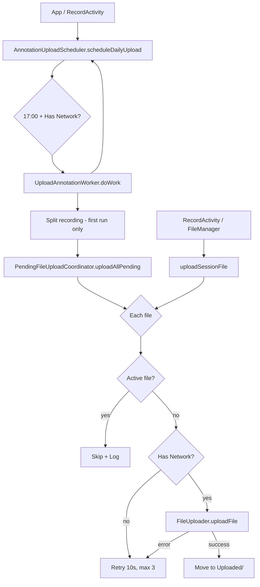
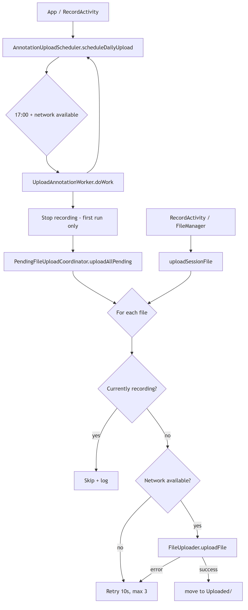

# Module — Network / Upload

> **Tier 3.** Network & upload module: upload coordination + retries, HTTP client, configurations, daily 17:00 schedule, file logging, and local annotation history.
> For details on each function, see [Tier 4 — functions-network-upload.md](../4-functions/functions-network-upload.md).

**12 classes:** `ApiService`, `RetrofitClient`, `UploadResponse`, `ApiConfig`, `NetworkConfig`, `FileUploader`, `NetworkHelper`, `PendingFileUploadCoordinator`, `UploadAnnotationWorker`, `AnnotationUploadScheduler`, `FileLogger`, `AnnotationHistory`.

| Area of Concern | Class | Role |
|---|---|---|
| HTTP API | `ApiService` + `RetrofitClient` | Defines `POST api/v1/file/upload` |
| Configuration | `ApiConfig`, `NetworkConfig` | URL/token from BuildConfig, OkHttp timeouts & retry constants |
| Upload Execution | `FileUploader` | Handles multipart requests, parses success message, moves file to `Uploaded/` |
| Retry/Batch/Safety | `PendingFileUploadCoordinator` | Manages 3-attempt limit, 10s delay, prevents uploading active files |
| 17:00 Schedule | `AnnotationUploadScheduler` → `UploadAnnotationWorker` | Manages 17:00 maintenance task via WorkManager |
| Network Gate | `NetworkHelper` | Checks network availability |
| Log | `FileLogger` | Generates file logs for diagnostics |
| Annotation UI (Local JSON) | `AnnotationHistory` | Local JSON annotations viewer |

---

## 1. `ApiService` (Retrofit interface)
`app/.../network/ApiService.java` — Defines the multipart upload endpoint.
`Call<UploadResponse> uploadFile(@Part MultipartBody.Part file, @Part("owner") RequestBody owner)` → `POST api/v1/file/upload`. (Legacy endpoints with `x-static-token`/`x-content-md5` headers are commented out in `FileUploader`.)

## 2. `RetrofitClient`
`app/.../network/RetrofitClient.java` — Thread-safe singleton that creates `Retrofit` (base URL + Gson + OkHttp timeouts).
`static Retrofit getInstance()`. Timeouts: connect 15s, read 20s, write 20s.

## 3. `UploadResponse`
`app/.../network/UploadResponse.java` — Gson DTO for server response. Exposes `getMessage()` (to check success state) and `getFile()` → inner `FileInfo` (`getId`, `getFilename`).

## 4. `ApiConfig`
`app/.../config/ApiConfig.java` — Constants for `BASE_URL` (from `BuildConfig.BASE_URL`, default `http://vital-ei.oucru.org/`) and `API_TOKEN` (from `local.properties`, default `YOUR_TOKEN_HERE`). The API token is currently **not sent** in active network calls.

## 5. `NetworkConfig`
`app/.../config/NetworkConfig.java` — `CONNECT_TIMEOUT_MS=15000`, `READ_TIMEOUT_MS=20000`, `WRITE_TIMEOUT_MS=20000` (used by RetrofitClient); `MAX_RETRY=3`, `RETRY_DELAY_MS=10000` (**reference only** — the coordinator redefines these locally).

## 6. `FileUploader`
`app/.../FileUploader.java` — Performs multipart upload (from content-URI or filepath), validates the response message, calculates MD5 hashes, and moves successfully uploaded files to the `Uploaded/` folder. **Does not retry internally** (the caller is responsible for retries).
- **Methods:** `setAppContext`, `uploadFile(activity, path, cb)` / `uploadFile(path, cb)`, `moveFileToUploadedFolder(FromUri)`, `calculateMD5`, `getBaseUrl`.
- **Inner Interface:** `UploadCallback`. The owner parameter is hardcoded to `"Vyyy"`; success is determined when the server message is ∈ `{"File uploaded successfully!", "File uploaded successfully"}`.

## 7. `NetworkHelper`
`app/.../NetworkHelper.java` — `static boolean isNetworkAvailable(Context)` (uses `NetworkCapabilities` on API 23+, falls back to legacy `NetworkInfo`).

## 8. `PendingFileUploadCoordinator`
`app/.../PendingFileUploadCoordinator.java` — **The central upload coordinator:** manages retries, verifies connectivity, **refuses to upload the currently active recording file**, and moves successfully uploaded files to `Uploaded/`.
- **Methods:** `uploadSessionFile(context, uri)` / `(context, activity, uri)`, `uploadAllPending(context)`.
- **Policies:** `MAX_ATTEMPTS=3`, `RETRY_DELAY_MS=10000`, `IN_FLIGHT` set to block duplicate uploads, check against `getCurrentOpenFileUriString()`, skips 0-byte `_unknown` files. Details: [flow-05 section 3](../2-architecture/flow-05-file-upload.md#3-retry--safety-policy).

## 9. `UploadAnnotationWorker`
`app/.../UploadAnnotationWorker.java` — WorkManager `Worker` for the 17:00 maintenance: (first run) broadcasts recording split event + sleeps for 3s, then runs `uploadAllPending()`, and schedules `scheduleDailyUpload()` for tomorrow. `doWork()` returns `Result.success()`.

## 10. `AnnotationUploadScheduler`
`app/.../AnnotationUploadScheduler.java` — `static scheduleDailyUpload(context)` schedules a self-chaining `OneTimeWorkRequest` named `smartcare_daily_17h_maintenance`, with a `NetworkType.CONNECTED` constraint, calculating the delay until the next **17:00** local time.

## 11. `FileLogger`
`app/.../FileLogger.java` — Logs text events to `{externalFilesDir}/Logs/smartcare_app_log.txt` (rolling files at 10MB). Used extensively by the upload coordinator for structured event logs.
- **Methods:** `getInstance`, `v/d/i/w/e`, `logEvent`, `logWarningEvent`, `logCrash`, `flushToDisk`, `getFilteredLogs`, `getLogFilePath`. **Enum:** `LogLevel`.

## 12. `AnnotationHistory`
`app/.../AnnotationHistory.java` — UI class for viewing/editing/deleting annotations saved locally in `Download/OximeterData/Annotation/Annotations.json`.
- **Note:** This class does not perform HTTP uploads (operates on local JSON). `static showAnnotationHistory(context, patientCode)`. See [flow-04](../2-architecture/flow-04-annotation.md).

---

## Flow Diagram

---

## Retry & Config Reference

| Class | Max Retries | Retry Delay | Notes |
|---|---|---|---|
| `NetworkConfig` | 3 (`MAX_RETRY`) | 10s | Documentational constant, coordinator does not import it |
| `PendingFileUploadCoordinator` | **3** (`MAX_ATTEMPTS`) | **10s** | Actual retry implementation |
| `FileUploader` | 0 | — | Single attempt; legacy retry code commented out |

| Config Variable | Source | Default Value |
|---|---|---|
| `BASE_URL` | `app/build.gradle` → BuildConfig | `http://vital-ei.oucru.org/` |
| `API_TOKEN` | `local.properties` → BuildConfig | `YOUR_TOKEN_HERE` |
| Daily Schedule | `AnnotationUploadScheduler` | **17:00** local time |
| Uploaded Directory | `FileUploader` (MediaStore) | `Download/OximeterData/Uploaded` |
