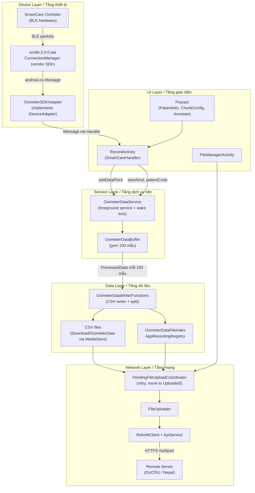

# Tầng 2 — Architecture Overview / Tổng quan kiến trúc

> **Mục tiêu:** Giải thích **hệ thống hoạt động thế nào** ở mức tổng thể, rồi dẫn bạn tới từng **flow** chi tiết.
> Đây là **Tầng 2**. Nếu chưa đọc [Tầng 1 — Project Overview](../1-overview/PROJECT-OVERVIEW.md), hãy đọc trước.

---

## 1. Kiến trúc 5 tầng / The 5 layers

App được chia thành **5 tầng**, dòng dữ liệu đi từ thiết bị → UI/Service → file → server.

---

## 2. Trách nhiệm từng tầng / Responsibility per layer

| Tầng | File chính | Trách nhiệm |
|---|---|---|
| **Device / Thiết bị** | `device/OximeterSDKAdapter`, `device/IDeviceAdapter`, `device/OximeterDataPacket`, `device/OximeterDataListener` | Cô lập SDK của hãng (`scolib-2.0.0.aar`); dịch callback SDK thành dữ liệu chuẩn của app. |
| **UI / Giao diện** | `RecordActivity`, `FileManagerActivity`, `PatientInfoPopup`, `ChunkFileConfigPopup`, `ShowAnnotate`, `AnnotationHistory` | Vẽ sóng PPG/HR/SpO₂/pin; nhập mã bệnh nhân; điều khiển start/stop; quản lý & upload file thủ công. |
| **Service / Dịch vụ nền** | `OximeterDataService`, `OximeterDataBuffer`, `RecordingSessionPrefs`, `RecordingConstants` | Chạy nền liên tục (foreground + wake lock); gom dữ liệu theo lô; sống sót khi bị kill. |
| **Data / Dữ liệu** | `OximeterDataWriterFunctions`, `OximeterDataFileIndex`, `AppRecordingRegistry`, `OximeterDataTreeAccess` | Ghi CSV qua MediaStore; cắt file theo thời gian; theo dõi trạng thái file (pending/uploaded). |
| **Network / Mạng** | `PendingFileUploadCoordinator`, `FileUploader`, `network/RetrofitClient`, `network/ApiService`, `config/ApiConfig`, `config/NetworkConfig` | Upload CSV (multipart) có retry; chuyển file đã upload sang `Uploaded/`; cấu hình URL/token/timeout. |
| **App / Khởi tạo** | `SmartCareApplication`, `FileLogger`, `MemoryDiagnostics`, `AnnotationUploadScheduler`, `UploadAnnotationWorker` | Khởi tạo logging + crash handler; lên lịch dọn/upload hằng ngày lúc 17:00. |

> Chi tiết từng class theo module xem **Tầng 3** — [`MODULES-INDEX.md`](../3-modules/MODULES-INDEX.md).

---

## 3. Hai nguyên tắc thiết kế quan trọng nhất / Two key design principles

### 3.1. UI và việc ghi file là HAI nhánh tách biệt

`RecordActivity` (Activity) chỉ lo **vẽ đồ thị**. Việc **ghi dữ liệu thật** nằm ở `OximeterDataService` (Service nền).
Nhờ tách rời, app **vẫn ghi được khi UI bị ẩn** (màn hình tắt, app xuống nền).

### 3.2. Cô lập SDK của hãng sau một Adapter

SDK của hãng (`ConnectionManager` trong `scolib-2.0.0.aar`) chỉ được chạm tới qua `OximeterSDKAdapter`
(implements `IDeviceAdapter`). Khi đổi phần cứng/SDK, **chỉ sửa một file adapter**, không đụng `RecordActivity`.
Xem hướng dẫn 3 bước trong [flow-02-bluetooth-connection.md](flow-02-bluetooth-connection.md#5-thay-sdk-phần-cứng-mới--swapping-the-device-sdk).

---

## 4. Danh sách các flow / The flows

Mỗi flow được mô tả trong một file riêng, kèm sequence/state diagram và "đọc code ở đâu":

| # | Flow | File | Tóm tắt |
|---|---|---|---|
| 1 | **App startup** | [flow-01-app-startup.md](flow-01-app-startup.md) | App khởi động, khởi tạo logging/crash handler, bắt buộc nhập mã BN, khôi phục phiên nếu có. |
| 2 | **Bluetooth connection** | [flow-02-bluetooth-connection.md](flow-02-bluetooth-connection.md) | Quét, kết nối, tự reconnect, chặn sự kiện BLE lạ, đổi SDK phần cứng. |
| 3 | **Data recording** | [flow-03-data-recording.md](flow-03-data-recording.md) | Một mẫu đi từ thiết bị → buffer (gom 100) → CSV; cắt file; chạy nền. |
| 4 | **Annotation** | [flow-04-annotation.md](flow-04-annotation.md) | Tạo/sửa/xóa ghi chú, lưu JSON, upload. |
| 5 | **File upload** | [flow-05-file-upload.md](flow-05-file-upload.md) | Hàng đợi upload, retry 3 lần, chuyển sang `Uploaded/`, lịch 17:00. |
| 6 | **File management** | [flow-06-file-management.md](flow-06-file-management.md) | Duyệt file pending/uploaded, upload thủ công, mở/xóa file, SAF fallback. |

---

## 5. Chống mất dữ liệu — tổng quan / Resilience at a glance

Đây là lý do kiến trúc trông phức tạp. Các cơ chế chính (chi tiết trong từng flow):

- **Foreground service + wake lock** → ghi tiếp khi màn hình tắt.
- **`START_STICKY` + `RecordingSessionPrefs`** → hệ thống kill process thì service tự khởi động lại và **ghi tiếp** phiên cũ.
- **Cắt CSV theo thời gian** → một sự cố chỉ hỏng một đoạn nhỏ, không hỏng toàn bộ phiên.
- **`onTaskRemoved` giữ service sống** khi user vuốt app khỏi Recents (để BLE còn cơ hội reconnect).
- **Crash handler** ghi log crash ra file trước khi app chết.
- **Upload không bao giờ đụng file đang ghi** → tránh hỏng writer.

---

## 6. Cấu hình / Configuration

Mọi giá trị môi trường nạp từ `local.properties` → `BuildConfig` → `ApiConfig`/`NetworkConfig`. Không hardcode.
Chi tiết xem [Tầng 1 mục 8](../1-overview/PROJECT-OVERVIEW.md#8-cấu-hình--server--configuration).

---

*Giữ tài liệu này cập nhật khi kiến trúc thay đổi. / Keep this updated when the architecture changes.*
