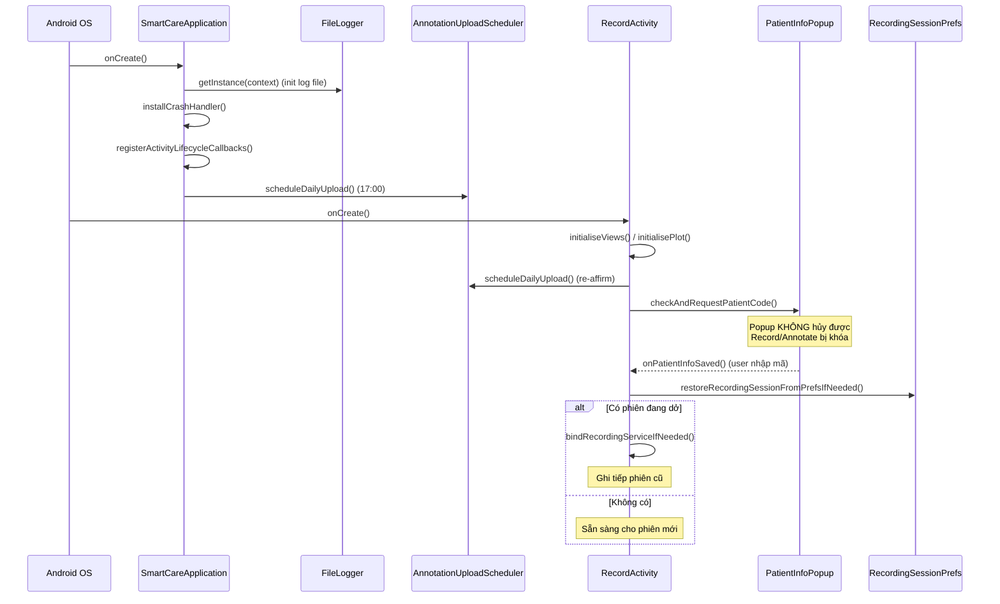
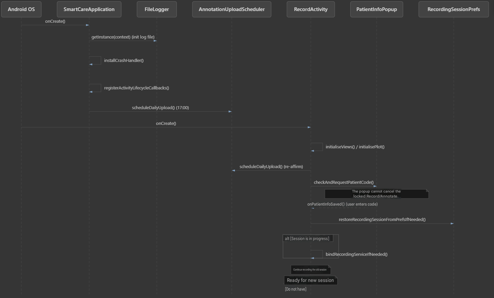

# Flow 01 — App Startup / Khởi động app

> **Tầng 2 · Flow 1.** App khởi động → khởi tạo hạ tầng (logging, crash handler, lịch upload) → bắt buộc nhập mã
> bệnh nhân → khôi phục phiên ghi nếu trước đó bị gián đoạn.

---

## 1. Tóm tắt / Summary

Khi app mở, hai thành phần khởi tạo theo thứ tự:

1. **`SmartCareApplication.onCreate()`** — chạy **một lần cho cả process**, dựng hạ tầng nền.
2. **`RecordActivity.onCreate()`** — chạy mỗi khi mở màn hình ghi, dựng UI và buộc nhập mã BN.

---

## 2. Sequence diagram

---

## 3. Các bước chi tiết / Step by step

### Bước 1 — `SmartCareApplication.onCreate()`
- Khởi tạo **`FileLogger`** (ghi log ra `{externalFilesDir}/Logs/smartcare_app_log.txt`).
- Gọi **`FileUploader.setAppContext()`** để upload nền hoạt động được.
- **`installCrashHandler()`** — bọc default uncaught-exception handler để **flush log crash ra file** trước khi app chết.
- Đăng ký **`ActivityLifecycleCallbacks`** để: áp inset thanh hệ thống (`SystemBarInsetsHelper`), log foreground/background,
  log lifecycle từng activity.
- **`AnnotationUploadScheduler.scheduleDailyUpload()`** — đặt lịch tác vụ nền 17:00 (xem [flow-05](flow-05-file-upload.md)).

### Bước 2 — `RecordActivity.onCreate()`
- `initialiseViews()`, `initialisePlot()`, `initialiseSeries()` — dựng UI và đồ thị AndroidPlot.
- Tạo `OximeterSDKAdapter` + `BluetoothEventInterceptor` (xem [flow-02](flow-02-bluetooth-connection.md)).
- `checkAndRequestPatientCode()` — hiện `PatientInfoPopup` **không hủy được**; **khóa** nút Record/Annotate cho tới khi
  user nhập **mã nghiên cứu** hợp lệ.

### Bước 3 — Khôi phục phiên / Session restore
- Sau khi có mã BN: `restoreRecordingSessionFromPrefsIfNeeded()` đọc `RecordingSessionPrefs`.
- Nếu có phiên đang active và **khớp mã BN** → `bindRecordingServiceIfNeeded()` để **ghi tiếp** (không tạo phiên mới).
- Đây là một mắt xích của cơ chế chống mất dữ liệu (xem thêm [flow-03 mục resilience](flow-03-data-recording.md#5-chống-mất-dữ-liệu--resilience)).

---

## 4. Đọc code ở đâu / Where to read the code

| Việc | File · method |
|---|---|
| Khởi tạo hạ tầng process | `SmartCareApplication.onCreate()` |
| Cài crash handler | `SmartCareApplication.installCrashHandler()` |
| Áp inset thanh hệ thống | `SystemBarInsetsHelper.apply(activity)` |
| Dựng UI màn hình ghi | `RecordActivity.onCreate()` → `initialiseViews()` |
| Buộc nhập mã BN | `RecordActivity.checkAndRequestPatientCode()` + `PatientInfoPopup.show()` |
| Khôi phục phiên | `RecordActivity.restoreRecordingSessionFromPrefsIfNeeded()`, `RecordingSessionPrefs.load()` |

---

## 5. Liên quan / Related

- [flow-02 — Bluetooth connection](flow-02-bluetooth-connection.md)
- [flow-03 — Data recording](flow-03-data-recording.md)
- Tầng 3: [module UI/Recording](../3-modules/module-ui-recording.md), [module Network/Upload](../3-modules/module-network-upload.md)
