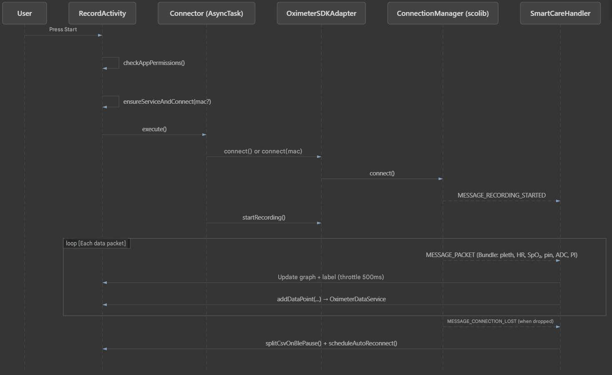

# Flow 02 — Bluetooth Connection / Kết nối Bluetooth

> **Tầng 2 · Flow 2.** Cách app quét, kết nối, giữ và tự kết nối lại oximeter qua BLE — và cách đổi SDK phần cứng
> mà không phải sửa UI.

---

## 1. Tóm tắt / Summary

- App kết nối qua **SDK của hãng** (`ConnectionManager` trong `scolib-2.3.0.aar`), được bọc bởi **`OximeterSDKAdapter`**.
- SDK trả sự kiện/dữ liệu về app dưới dạng **`android.os.Message`** gửi qua **`Handler`** (`RecordActivity.SmartCareHandler`) —
  **không** dùng interface `OximeterDataListener` (lớp đó còn trong repo nhưng đã bị thay thế).
- App có **tự quét nền** và **tự reconnect**, đồng thời **chặn các sự kiện BLE của thiết bị lạ** bằng
  `BluetoothEventInterceptor`.
- **`PacketStatsTracker`** (trên `MESSAGE_PACKET`) theo dõi gap `KEY_DATA_COUNTER` của thiết bị, ghi tổng hợp mỗi phút
  vào `FileLogger`, và bỏ qua gap không hợp lý trên `MAX_PLAUSIBLE_GAP = 1000`.

---

## 2. Sequence diagram — kết nối & nhận dữ liệu

```mermaid
sequenceDiagram
    participant U as User
    participant RA as RecordActivity
    participant CN as Connector (AsyncTask)
    participant ADP as OximeterSDKAdapter
    participant SDK as ConnectionManager (scolib)
    participant H as SmartCareHandler

    U->>RA: bấm Start
    RA->>RA: checkAppPermissions()
    RA->>RA: ensureServiceAndConnect(mac?)
    RA->>CN: execute()
    CN->>ADP: connect() hoặc connect(mac)
    ADP->>SDK: connect()
    SDK-->>H: MESSAGE_RECORDING_STARTED
    CN->>ADP: startRecording()
    loop Mỗi gói dữ liệu
        SDK-->>H: MESSAGE_PACKET (Bundle: pleth, HR, SpO₂, pin, ADC, PI, counter)
        H->>RA: cập nhật đồ thị + nhãn (throttle 500ms)
        H->>RA: PacketStatsTracker.onPacketReceived(counter)
        H->>RA: addDataPoint(...) → OximeterDataService
    end
    SDK-->>H: MESSAGE_CONNECTION_LOST (khi rớt)
    H->>RA: splitCsvOnBlePause() + scheduleAutoReconnect()
    Note over RA: splitFileOnBlePause đóng đoạn nếu ≥ 60s;<br/>KHÔNG mở lại — CSV tiếp theo mở lười khi có packet đầu
```



---

## 3. Các loại Message từ SDK / SDK messages

`SmartCareHandler.handleMessage()` phân nhánh theo `msg.what`:

| Message | App làm gì |
|---|---|
| `MESSAGE_PACKET` | Bóc pleth/HR/SpO₂/pin/ADC/PI; vẽ đồ thị (buffer 500 mẫu); cập nhật nhãn (throttle 500ms); ghi qua service; đẩy `KEY_DATA_COUNTER` vào `PacketStatsTracker`. |
| `MESSAGE_RECORDING_STARTED` | Toast model/giờ/sample rate; bật nút Stop; ngừng quét. |
| `MESSAGE_RECORDING_ENDED` | Toast; cắt CSV; reset nút về Start; quét lại. |
| `MESSAGE_CONNECTION_LOST` | Toast; cắt CSV; nếu phiên còn active → `stopDisconnectExit(false)` (chỉ ngắt BLE); đánh dấu disconnected. |
| `MESSAGE_DEVICE_NOT_FOUND` | Toast; quét lại; có thể ngắt một phần nếu phiên active. |
| `MESSAGE_NO_DATA_AVAILABLE` / `MESSAGE_UNKNOWN_OXIMETER` | Toast cảnh báo. |
| `MESSAGE_BLUETOOTH_OFF` / `MESSAGE_BLUETOOTH_UNAVAILABLE` | Toast: Bluetooth tắt/không khả dụng. |
| `MESSAGE_CLOCATION_PERMISSION_REQUIRED` / `MESSAGE_FLOCATION_PERMISSION_REQUIRED` | Toast: thiếu quyền location. |

---

## 4. Tự kết nối lại & chặn sự kiện lạ / Auto-reconnect & event filtering

### Tự reconnect
- `scheduleAutoReconnect(mac, delayMs)` — vòng lặp thử lại: **lần đầu sau 30s**, sau đó **mỗi 3 phút**.
- `startBluetoothBackgroundScan()` — quét nền **mỗi 5s** (chỉ bật sau khi đã nhập mã BN).
- Khi BLE rớt giữa phiên: `splitCsvOnBlePause()` → `splitFileOnBlePause()` **đóng/chốt** đoạn CSV hiện tại nếu
  thời lượng ≥ `MIN_SEGMENT_MS` (60s); **không** mở lại file mới. CSV tiếp theo chỉ mở **lười** qua
  `ensureRecordingActive` / `startDataCollection` khi có packet đầu sau reconnect. Phiên 24h **vẫn tiếp tục**.

### PacketStatsTracker (chẩn đoán thiết bị/UI)
- Mỗi `MESSAGE_PACKET`, `PacketStatsTracker.onPacketReceived(deviceCounter)` kiểm tra gap của `KEY_DATA_COUNTER` thiết bị.
- Gap hợp lý (≤ `MAX_PLAUSIBLE_GAP = 1000`) được tính là packet mất; gap lớn hơn coi là reset/wrap bộ đếm (log resync, không tính mất).
- Ghi **tổng hợp mỗi phút** vào `FileLogger` khi tracker đang chạy.

### Chặn sự kiện BLE của thiết bị lạ
- `BluetoothEventInterceptor` là `BroadcastReceiver` ưu tiên cao (`SYSTEM_HIGH_PRIORITY`), bắt
  `ACTION_ACL_CONNECTED/DISCONNECTED` **trước** khi SDK thấy, và `abortBroadcast()` cho thiết bị **không phải** máy của ta.
- Mục đích: tránh việc một thiết bị Bluetooth khác (tai nghe, đồng hồ…) ngắt kết nối làm SDK tưởng oximeter rớt.

> **Lưu ý:** `BluetoothAutoConnector.java` cũng tồn tại nhưng **hiện không được dùng** — `RecordActivity` tự cài
> logic quét/reconnect riêng. Xem [module device](../3-modules/module-device-bluetooth.md).

---

## 5. Thay SDK phần cứng mới / Swapping the device SDK

Khi hãng cấp SDK mới (`.aar`/`.jar`), chỉ cần **3 bước**, **không đụng `RecordActivity`**:

**Bước 1 — Thay thư viện:** đặt file mới vào `app/libs/`, cập nhật tên dependency trong `app/build.gradle`.

**Bước 2 — Sửa `device/OximeterSDKAdapter.java` (file DUY NHẤT cần sửa):**
1. Cập nhật `import` cho SDK mới.
2. Thay chỗ khởi tạo SDK cũ bằng SDK mới.
3. Sửa `connect()`, `disconnect()`, `startRecording()` để gọi method tương ứng của SDK mới.

**Bước 3 — Map dữ liệu về qua Handler Message:** khi SDK mới có callback (kết nối / dữ liệu mới), dựng một `Message`
mô phỏng cấu trúc SDK cũ và gửi qua `Handler`:

```java
Message msg = handler.obtainMessage(ConnectionManager.MESSAGE_PACKET);
Bundle data = new Bundle();
// data.putInt(ConnectionManager.KEY_DATA_PULSE, newSdkHeartRate);
// data.putDouble(ConnectionManager.KEY_DATA_SPO2, newSdkSpO2);
// data.putInt(ConnectionManager.KEY_DATA_PLETH, newSdkPlethValue);
msg.setData(data);
handler.sendMessage(msg); // dispatch tới RecordActivity y như cũ
```

### Workaround đáng chú ý: reflection bỏ lọc tên thiết bị
Trong constructor `OximeterSDKAdapter`, app dùng **reflection** ghi đè mảng tên thiết bị hardcoded của SDK
(class obfuscated `com.smartcare.oximetry.library.a`, field `d` kiểu `String[]`), set `names[0] = ""` để **khớp mọi thiết bị**
(hỗ trợ model mới như FC0392). Đây là *workaround phụ thuộc nội bộ SDK* — **phải kiểm tra lại sau mỗi lần nâng cấp `.aar`**.

---

## 6. Đọc code ở đâu / Where to read the code

| Việc | File · method |
|---|---|
| Bắt đầu kết nối | `RecordActivity.connectToPulseOximeter()` → `ensureServiceAndConnect()` → inner `Connector` |
| Ngắt kết nối / dừng | inner `Disconnector`, `RecordActivity.stopDisconnectExit(boolean)` |
| Nhận dữ liệu/sự kiện SDK | `RecordActivity.SmartCareHandler.handleMessage()` |
| Chẩn đoán gap bộ đếm packet | `PacketStatsTracker.onPacketReceived()`, tổng hợp phút → `FileLogger` |
| Bọc SDK của hãng | `device/OximeterSDKAdapter` (`connect`, `disconnect`, `startRecording`) |
| Hợp đồng adapter | `device/IDeviceAdapter` |
| Chặn sự kiện BLE lạ | `BluetoothEventInterceptor` |
| Quét nền & reconnect | `RecordActivity.startBluetoothBackgroundScan()`, `scheduleAutoReconnect()` |

---

## 7. Liên quan / Related

- [flow-03 — Data recording](flow-03-data-recording.md) (dữ liệu sau khi kết nối đi đâu)
- Tầng 3: [module Device/Bluetooth](../3-modules/module-device-bluetooth.md)
- Tầng 4: [functions Device/Bluetooth](../4-functions/functions-device-bluetooth.md)
