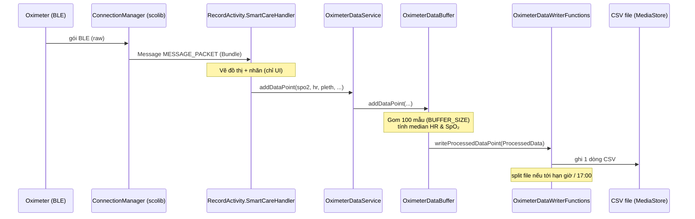
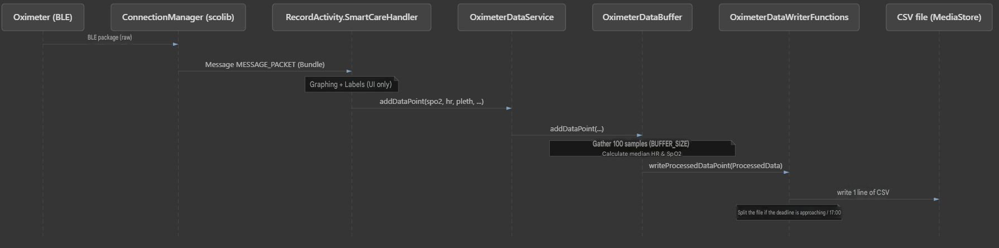
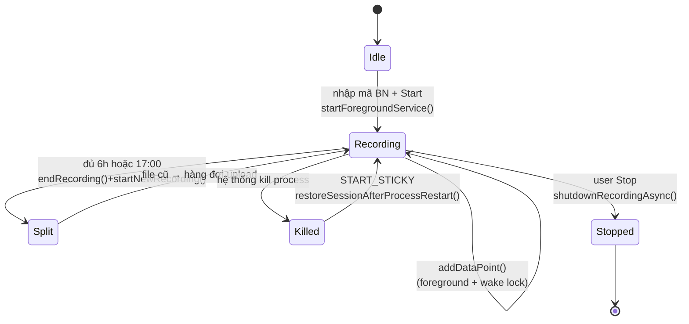

# Flow 03 — Data Recording / Ghi dữ liệu

> **Tầng 2 · Flow 3.** Đây là **luồng quan trọng nhất**: một mẫu dữ liệu đi từ máy đo → buffer (gom 100 mẫu) →
> file CSV, chạy nền và chống mất dữ liệu.

---

## 1. Một mẫu đi từ thiết bị đến file / One sample, device → file

---

## 2. Các điểm cần nhớ / Key points

1. **UI ≠ ghi file.** `SmartCareHandler` vừa cập nhật đồ thị (nhánh UI), vừa đẩy mẫu sang `OximeterDataService`
   (nhánh ghi). Service mới là nơi **ghi thật** → ghi tiếp được khi UI ẩn.

2. **Gom lô 100 mẫu.** `OximeterDataBuffer` gom đúng **`BUFFER_SIZE = 100`** mẫu rồi mới phát ra một `ProcessedData`:
   - `hr` và `o2` (SpO₂) = **median** của 100 mẫu (làm mượt nhiễu).
   - `pleth`, `red`, `ir`, `perfusion` = **mảng đầy đủ** từng mẫu (không lấy median).
   - `timestamp` = thời điểm của mẫu **giữa** lô.
   - Lý do gom lô: giảm số lần ghi đĩa + làm mượt dữ liệu.

3. **Lô lẻ không bị mất.** Khi dừng/cắt/BLE rớt, `flushRemaining()` đẩy nốt phần < 100 mẫu ra CSV.

4. **Ghi qua MediaStore.** `OximeterDataWriterFunctions` ghi vào `Download/OximeterData/`. Cột CSV:
   `timestamp, device_id, battery, hr, o2, spo2_status, pleth, red, ir, perfusion`.
   Tên file: `SmartCareCsv_{patientCode}_{startStamp}_{endStamp}.csv` (đoạn đang ghi dùng `unknown` ở phần end cho tới khi đóng).

---

## 3. Cắt file (split) / File splitting

App **cắt phiên dài thành nhiều file CSV nhỏ** để giới hạn thiệt hại khi lỗi:

| Lý do cắt | Method | Điều kiện |
|---|---|---|
| Đủ chu kỳ giờ | `writeProcessedDataPoint()` → `splitFileLocked()` | `now >= nextSplitTime` và đoạn ≥ `MIN_SEGMENT_MS` (60s). Chu kỳ mặc định **6 giờ** (`SPLIT_INTERVAL_HOURS`). |
| BLE rớt | `splitFileOnBlePause()` | Đóng/chốt đoạn hiện tại nếu thời lượng ≥ `MIN_SEGMENT_MS` (60s); **không** mở lại. CSV tiếp theo mở lười qua `ensureRecordingActive` / `startDataCollection` khi có packet đầu sau reconnect. |
| Mốc 17:00 hằng ngày | `splitForDailyCutoff()` | Tác vụ nền phát broadcast `ACTION_SPLIT_RECORDING`. |
| Bắt đầu phiên mới | `startNewRecording()` | Đóng đoạn cũ, dọn file `_unknown` mồ côi. |
| Dừng | `endRecording()` | Đóng writer, đổi tên sang giờ end thật, trả về URI. |

---

## 4. Chạy nền / Background recording

- **`OximeterDataService`** là foreground service (type `CONNECTED_DEVICE` trên API 29+) giữ **partial wake lock**
  (`"OximeterDataService::WakeLock"`) để CPU thức khi màn hình tắt.
- **Mở CSV lười (nhấn mạnh):** service khi bind/arm **chưa mở file**. Không có CSV cho tới khi **mẫu đầu tiên** tới
  (`addDataPoint` → `ensureRecordingActive` / `startDataCollection`). Tránh CSV rỗng chỉ có header khi chưa có thiết bị,
  và khớp hành vi BLE pause (chỉ đóng, không mở lại file rỗng).
- **Ước lượng thời lượng (File Manager):** UI dùng `size / BYTES_PER_RECORDING_HOUR` với
  `BYTES_PER_RECORDING_HOUR = 10 MiB` ≈ 1 giờ ghi (xem [flow-06](flow-06-file-management.md)).

---

## 5. Chống mất dữ liệu / Resilience

| Cơ chế | Cách hoạt động |
|---|---|
| **`START_STICKY` + `RecordingSessionPrefs`** | Khi process bị kill, service restart với `intent == null` → `restoreSessionAfterProcessRestart()` nạp lại phiên và ghi tiếp. |
| **`onTaskRemoved` giữ sống** | Nếu phiên còn active, service **không tự tắt** khi user vuốt app khỏi Recents (để BLE reconnect). |
| **Cắt file theo thời gian** | Sự cố chỉ ảnh hưởng một đoạn, không hỏng toàn bộ phiên. |
| **Flush lô lẻ** | `flushBufferedData()` / `flushRemaining()` đẩy nốt phần chưa đủ 100 mẫu trước khi đóng. |
| **Log drop có throttle** | Nếu mẫu bị rớt (service chưa sẵn sàng), log cảnh báo tối đa 1 lần/10s. |

---

## 6. Đọc code ở đâu / Where to read the code

| Việc | File · method |
|---|---|
| Nhận gói & tách dữ liệu | `RecordActivity.SmartCareHandler.handleMessage()` (`MESSAGE_PACKET`) |
| Đẩy mẫu vào service | `OximeterDataService.addDataPoint(...)` |
| Gom 100 mẫu + median | `OximeterDataBuffer.addDataPoint()`, `flushRemaining()`, `calculateMedian()` |
| Ghi CSV + cắt file | `OximeterDataWriterFunctions.writeProcessedDataPoint()`, `startNewRecording()`, `endRecording()`, `splitFileOnBlePause()` |
| Chạy nền/wake lock | `OximeterDataService.onStartCommand()`, `acquireWakeLock()`, `onTaskRemoved()` |
| Khôi phục sau kill | `OximeterDataService.restoreSessionAfterProcessRestart()`, `RecordingSessionPrefs` |
| Hằng số (chu kỳ cắt, segment tối thiểu, bytes/giờ) | `RecordingConstants` (`SPLIT_INTERVAL_HOURS`, `MIN_SEGMENT_MS`, `BYTES_PER_RECORDING_HOUR`) |

---

## 7. Muốn đổi X thì vào đâu / Tweak points

| Tôi muốn… | Vào |
|---|---|
| Đổi kích thước lô / median window | `OximeterDataBuffer.BUFFER_SIZE` |
| Đổi chu kỳ cắt file | `RecordingConstants.SPLIT_INTERVAL_HOURS` |
| Đổi cột/định dạng CSV | `OximeterDataWriterFunctions` (header + `writeProcessedDataPoint`) |
| Thêm trường dữ liệu mới từ thiết bị | `OximeterDataPacket` → `RecordActivity` (parse Message) → `OximeterDataService.addDataPoint` → `OximeterDataBuffer` → `OximeterDataWriterFunctions` |

---

## 8. Liên quan / Related

- [flow-02 — Bluetooth connection](flow-02-bluetooth-connection.md) · [flow-05 — File upload](flow-05-file-upload.md)
- Tầng 3: [module Data/Storage](../3-modules/module-data-storage.md), [module Device/Bluetooth](../3-modules/module-device-bluetooth.md)
- Tầng 4: [functions Data/Storage](../4-functions/functions-data-storage.md)
