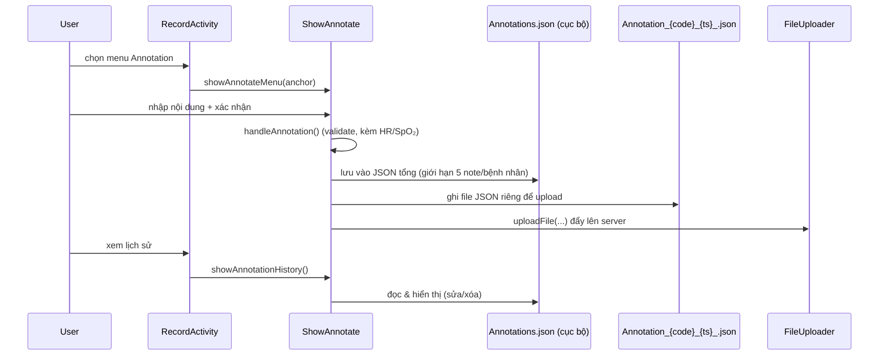
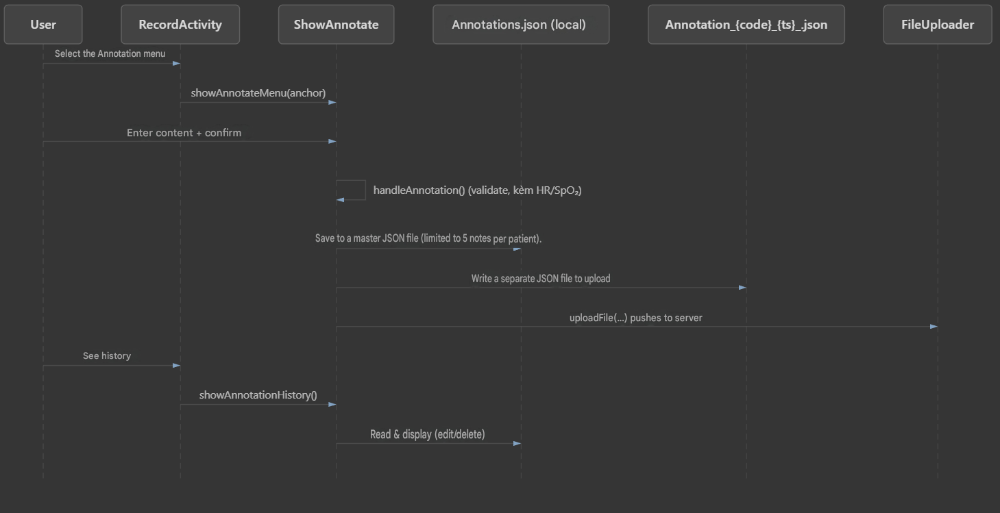

# Flow 04 — Annotation / Ghi chú sự kiện

> **Tầng 2 · Flow 4.** Cách nhân viên thêm ghi chú lâm sàng trong lúc đo, app lưu JSON cục bộ và upload.

---

## 1. Tóm tắt / Summary

- Trong lúc ghi, user mở menu **Add Note** (`ShowAnnotate`) để nhập ghi chú có cấu trúc
  (ngày, PPG/ECG, trạng thái thu, lý do…).
- Mỗi ghi chú được lưu vào **file JSON tổng** cục bộ và **một file JSON riêng** để upload, kèm HR/SpO₂ hiện thời.
- Có màn hình **lịch sử ghi chú** (`AnnotationHistory`) để xem/sửa/xóa theo mã bệnh nhân.

> Lưu ý đặt tên: dù có tên "annotation", **`AnnotationHistory` chỉ thao tác JSON cục bộ**, không phải tầng upload HTTP.
> Tác vụ nền tên `UploadAnnotationWorker`/`AnnotationUploadScheduler` thực ra là **lịch upload chung 17:00** (xem [flow-05](flow-05-file-upload.md)).

---

## 2. Sequence diagram

---

## 3. Các bước chi tiết / Step by step

1. **Mở menu:** `RecordActivity` (menu Annotation) → `ShowAnnotate.showAnnotateMenu(anchorView)`.
   Dialog có validate và các trường lý do hiện theo điều kiện.
2. **Lưu:** `handleAnnotation()` (private) nạp/ghi JSON tổng, **giới hạn 5 ghi chú/bệnh nhân**, đính kèm
   `annotationHeartRate`/`annotationSpO2` mới nhất (giá trị vitals tại thời điểm ghi chú).
3. **Xuất để upload:** ghi `Annotation_{code}_{timestamp}_.json` dưới `Download/OximeterData`, rồi upload qua `FileUploader`.
4. **Xem lịch sử:** `AnnotationHistory.showAnnotationHistory(context, patientCode)` hiện bảng theo mã BN, mới nhất trước;
   chạm dòng → sửa/xóa.

**Model `AnnotationEntry`:** `timestamp`, `patientCode`, `note`, `heartRate`, `spO2`.

---

## 4. Đọc code ở đâu / Where to read the code

| Việc | File · method |
|---|---|
| Hiện dialog thêm ghi chú | `ShowAnnotate.showAnnotateMenu(View)` |
| Lưu/validate ghi chú | `ShowAnnotate.handleAnnotation()` (private) |
| Sửa/xóa ghi chú | `ShowAnnotate.updateAnnotation()/deleteAnnotation()`; `AnnotationHistory` |
| Xem lịch sử | `AnnotationHistory.showAnnotationHistory()` |
| Vitals dùng cho ghi chú | `RecordActivity.annotationHeartRate`, `annotationSpO2` |

---

## 5. Lưu ý kỹ thuật / Notes

- Các vitals `annotationHeartRate`/`annotationSpO2` hiện là **biến static** trong `RecordActivity` (xem mục "known issues"
  trong [README docs](../README.md#known-issues--nợ-kỹ-thuật)) — có thể gây giá trị cũ giữa các phiên; cần cẩn thận khi refactor.

---

## 6. Liên quan / Related

- [flow-05 — File upload](flow-05-file-upload.md) (annotation cũng đi qua upload)
- Tầng 3: [module UI/Recording](../3-modules/module-ui-recording.md), [module Network/Upload](../3-modules/module-network-upload.md)
