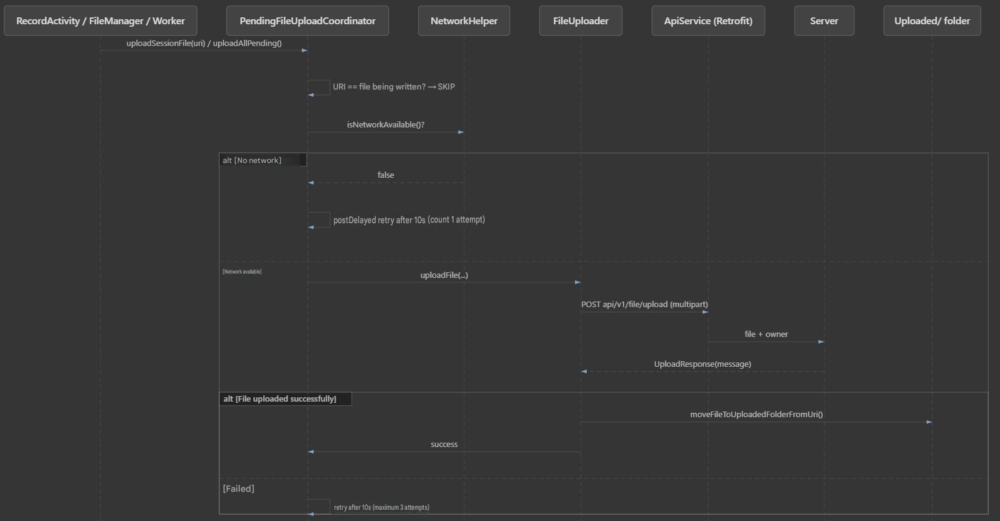
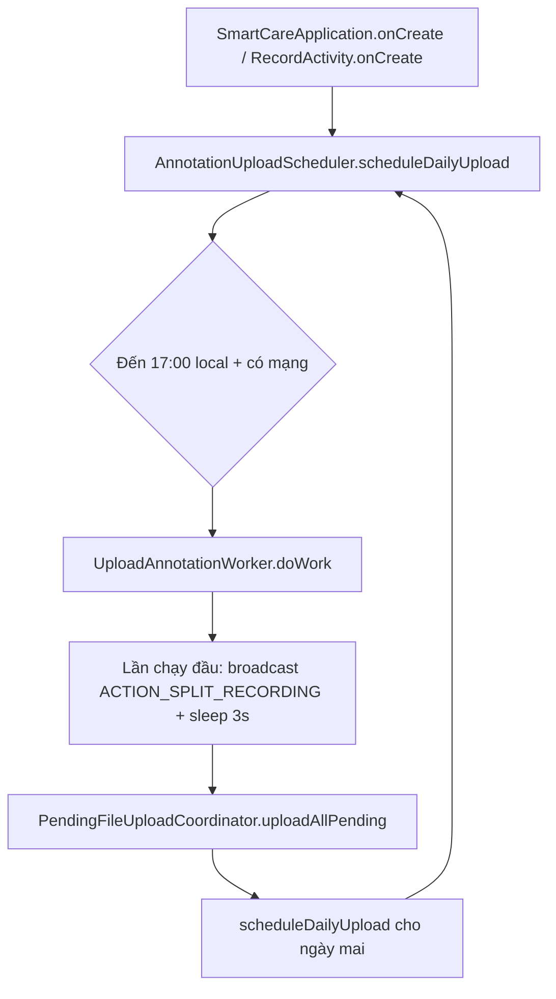

# Flow 05 — File Upload / Upload file

> **Tầng 2 · Flow 5.** Cách file CSV/annotation được đưa vào hàng đợi, upload có retry, và chuyển sang `Uploaded/`.

---

## 1. Bốn con đường upload / Four upload paths

Ba đường CSV/annotation đi qua **`PendingFileUploadCoordinator`** (retry tối đa **3 lần**, kiểm tra mạng):

1. **Tự động sau khi đóng file** — khi split hoặc dừng phiên, file vừa đóng được đẩy vào hàng đợi
   (`RecordActivity` gọi `uploadSessionFile`).
2. **Thủ công** — từ `FileManagerActivity`, user chọn file để upload lại.
3. **Hằng ngày 17:00** — `AnnotationUploadScheduler` lên lịch `UploadAnnotationWorker` (WorkManager) chạy lúc **17:00**
   để upload nốt phần còn tồn (`uploadAllPending`).

Đường thứ tư **bỏ qua** coordinator (không chuyển log sang `Uploaded/`):

4. **Báo lỗi (bug report)** — `BugReportDialog` ghi thêm mục `USER` / `BUG_REPORT` vào các file log ngày đã chọn,
   rồi gọi `FileUploader.uploadFile` **tuần tự** với tên server tùy chỉnh
   `SmartCareLog_{patient}_{dd.MM.yyyy.HH.mm.ss}_.txt` (ngày lấy từ ngày của file log, giờ = lúc upload;
   thêm `_1` / `_2` khi trùng tên). Log vẫn nằm trong `{externalFilesDir}/Logs/`.

---

## 2. Sequence diagram — một lần upload

```mermaid
sequenceDiagram
    participant SRC as RecordActivity / FileManager / Worker
    participant COORD as PendingFileUploadCoordinator
    participant NET as NetworkHelper
    participant UP as FileUploader
    participant API as ApiService (Retrofit)
    participant SRV as Server
    participant FS as Uploaded/ folder

    SRC->>COORD: uploadSessionFile(uri) / uploadAllPending()
    COORD->>COORD: URI == file đang ghi? → BỎ QUA
    COORD->>NET: isNetworkAvailable()?
    alt Không có mạng
        NET-->>COORD: false
        COORD->>COORD: postDelayed retry sau 10s (đếm 1 lần thử)
    else Có mạng
        COORD->>UP: uploadFile(...)
        UP->>API: POST api/v1/file/upload (multipart)
        API->>SRV: file + owner
        SRV-->>UP: UploadResponse(message)
        alt "File uploaded successfully"
            UP->>FS: moveFileToUploadedFolderFromUri()
            UP->>COORD: success
        else thất bại
            COORD->>COORD: retry sau 10s (tối đa 3 lần)
        end
    end
```

---

## 3. Chính sách retry & an toàn / Retry & safety policy

> Vị trí code dưới đây trỏ tới **tên method** trong `PendingFileUploadCoordinator.java` (không nêu số dòng vì code
> sẽ thay đổi theo thời gian).

| Tham số | Giá trị | Hành vi (và vị trí trong code) |
|---|---|---|
| `MAX_ATTEMPTS` | **3** | Đếm theo từng URI; quá 3 lần thất bại → bỏ, xóa bộ đếm. → khai báo là hằng số lớp; thực thi trong `uploadWithRetry()`. |
| `RETRY_DELAY_MS` | **10.000 ms** | Thất bại mạng/upload → `Handler.postDelayed` thử lại sau 10s. → khai báo là hằng số lớp; dùng trong `scheduleRetry()`. |
| In-flight guard | `IN_FLIGHT` set | Cùng một URI không upload song song. → kiểm tra/thêm/gỡ trong `uploadWithRetry()` (và gỡ trong callback `onUploadComplete()`). |
| **Open-file guard** | so với `getCurrentOpenFileUriString()` | **Không bao giờ** upload file đang ghi (tránh hỏng writer). → path đơn lẻ trong `uploadSessionFile()`; path batch trong `shouldSkipPendingEntry()`. |
| Network check | `NetworkHelper.isNetworkAvailable()` | Không có mạng → lên lịch retry (tính 1 lần thử). → trong `uploadWithRetry()`. |
| Skip file rỗng | `shouldSkipPendingEntry()` | Bỏ qua file `*_unknown` **0 byte**; cho phép file unknown không rỗng (khôi phục sau crash). → `shouldSkipPendingEntry()`. |
| Thành công | `moveFileToUploadedFolderFromUri()` | Chuyển sang `Download/OximeterData/Uploaded` + `AppRecordingRegistry.markUploaded()`. → callback `onUploadComplete()` (khi `success`) gọi `moveFileToUploadedFolderFromUri()`. |

> **Lưu ý cấu hình:** `NetworkConfig.MAX_RETRY=3` và `RETRY_DELAY_MS=10000` chỉ mang tính **tài liệu/tham chiếu**;
> bản thực thi retry nằm trong `PendingFileUploadCoordinator` (định nghĩa lại local). `FileUploader` **không tự retry**
> (chỉ upload một lần) — retry do coordinator lo.

---

## 4. Lịch 17:00 hằng ngày / Daily 17:00 schedule

- Dùng `OneTimeWorkRequest` **tự nối tiếp** (không phải `PeriodicWorkRequest`), tên work `smartcare_daily_17h_maintenance`,
  `ExistingWorkPolicy.REPLACE`, ràng buộc `NetworkType.CONNECTED`.
- Lần chạy đầu (`getRunAttemptCount() == 0`) sẽ **cắt file đang ghi** trước, rồi mới upload; các lần retry nội bộ của
  WorkManager thì bỏ bước cắt.

---

## 5. Endpoint & cấu hình / Endpoint & config

- Endpoint: `POST api/v1/file/upload` (`ApiService.uploadFile`), gửi phần file + trường `owner` (hardcode `"Vyyy"`).
- `RetrofitClient` dùng `ApiConfig.BASE_URL` + timeout từ `NetworkConfig` (connect 15s, read/write 20s).
- Thành công khi `message` ∈ `{"File uploaded successfully!", "File uploaded successfully"}`.
- `BASE_URL`/`API_TOKEN` nạp từ `local.properties` → `BuildConfig` → `ApiConfig` (xem [Tầng 1 mục 8](../1-overview/PROJECT-OVERVIEW.md#8-cấu-hình--server--configuration)).
- **`API_TOKEN` có trong `BuildConfig` / `ApiConfig` nhưng hiện không được gắn vào multipart upload**
  (tham số token của biến thể endpoint cũ đang bị comment trong `FileUploader`).

---

## 6. Đọc code ở đâu / Where to read the code

| Việc | File · method |
|---|---|
| Điều phối upload + retry | `PendingFileUploadCoordinator.uploadSessionFile()`, `uploadAllPending()` |
| Upload HTTP thực tế | `FileUploader.uploadFile()`, `moveFileToUploadedFolderFromUri()` |
| Upload log báo lỗi | `BugReportDialog.show()` → `FileLogger.appendUserReportToFile()` → `FileUploader.uploadFile(...)` tuần tự |
| Định nghĩa endpoint | `network/ApiService`, `network/RetrofitClient`, `network/UploadResponse` |
| Kiểm tra mạng | `NetworkHelper.isNetworkAvailable()` |
| Lịch 17:00 | `AnnotationUploadScheduler.scheduleDailyUpload()`, `UploadAnnotationWorker.doWork()` |
| Cấu hình URL/token/timeout | `config/ApiConfig`, `config/NetworkConfig` |

---

## 7. Liên quan / Related

- [flow-03 — Data recording](flow-03-data-recording.md) · [flow-06 — File management](flow-06-file-management.md)
- Tầng 3: [module Network/Upload](../3-modules/module-network-upload.md)
- Tầng 4: [functions Network/Upload](../4-functions/functions-network-upload.md)
