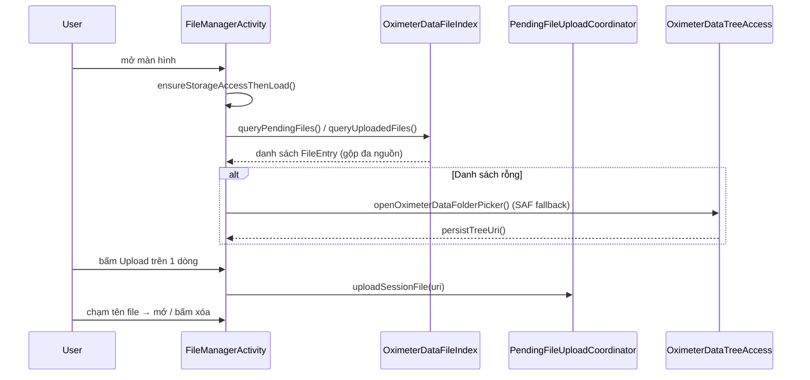
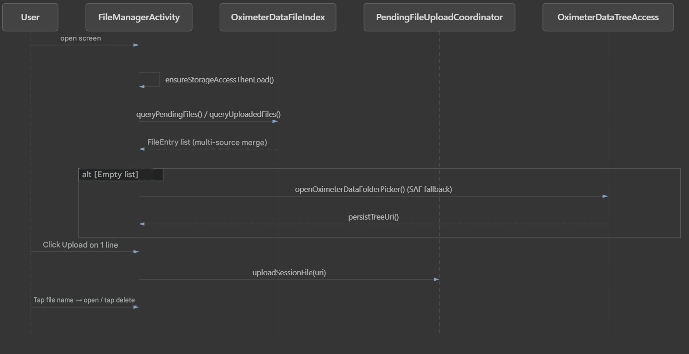

# Flow 06 — File Management / Quản lý file

> **Tầng 2 · Flow 6.** Màn hình `FileManagerActivity` để duyệt file đã ghi (pending) và đã upload (uploaded),
> upload thủ công, mở/xóa file, kèm các cơ chế fallback để liệt kê file trên thiết bị "khó tính".

---

## 1. Tóm tắt / Summary

- `FileManagerActivity` có **2 tab**: **Pending** (chưa upload) và **Uploaded** (đã upload), đọc từ
  `Download/OximeterData`.
- Danh sách file được tổng hợp từ **nhiều nguồn** qua `OximeterDataFileIndex` để chắc chắn không sót file trên các máy
  mà MediaStore trả thiếu (đặc biệt Samsung + MTP).
- Có **observer** theo dõi MediaStore để cập nhật live khi đang ghi.

---

## 2. Sequence diagram

---

## 3. Nguồn dữ liệu liệt kê file / Where the file list comes from

`OximeterDataFileIndex` **gộp** nhiều nguồn để ra danh sách cuối:
- Quét đĩa trực tiếp (`Download/OximeterData`, kể cả thư mục typo `OximetaData`).
- MediaStore Downloads + MediaStore Files volume.
- `AppRecordingRegistry` (sổ đăng ký URI đã ghi — cứu khi MediaStore thiếu `RELATIVE_PATH`).
- Cây tài liệu SAF (`OximeterDataTreeAccess`) nếu user đã cấp quyền thư mục.

Chỉ nhận các file là dữ liệu app: `SmartCareCsv*.csv` hoặc `Annotation_*.json` (loại trừ `Annotations.json` tổng).

---

## 4. Các thao tác / Operations

| Thao tác | Method |
|---|---|
| Tải lại danh sách (nền) | `refreshFileLists()` / `refreshFileListsQuiet()` |
| Upload thủ công 1 file | dòng Pending → `PendingFileUploadCoordinator.uploadSessionFile()` |
| Mở file | `openCsvFile()` (qua `ACTION_VIEW` + FileProvider/content URI) |
| Xóa file đã upload | `deleteUploadedFile()` |
| Quan sát thay đổi khi đang ghi | observer `MediaStore.Downloads` (đăng ký ở `onResume`, hủy ở `onPause`) |
| Fallback quyền thư mục | `openOximeterDataFolderPicker()` (SAF `ACTION_OPEN_DOCUMENT_TREE`) |

---

## 5. Đọc code ở đâu / Where to read the code

| Việc | File · method |
|---|---|
| Vòng đời màn hình | `FileManagerActivity.onCreate/onResume/onPause/onDestroy` |
| Liệt kê file (gộp nguồn) | `OximeterDataFileIndex.queryPendingFiles()/queryUploadedFiles()` |
| Adapter danh sách | inner `CsvFileAdapter` (pending), `UploadedFileAdapter` (uploaded), `CsvFile` (wrapper) |
| Quyền SAF | `OximeterDataTreeAccess.getPersistedTreeUri()/persistTreeUri()` |
| Sổ đăng ký file | `AppRecordingRegistry` |

---

## 6. Liên quan / Related

- [flow-05 — File upload](flow-05-file-upload.md)
- Tầng 3: [module Data/Storage](../3-modules/module-data-storage.md), [module UI/Recording](../3-modules/module-ui-recording.md)
