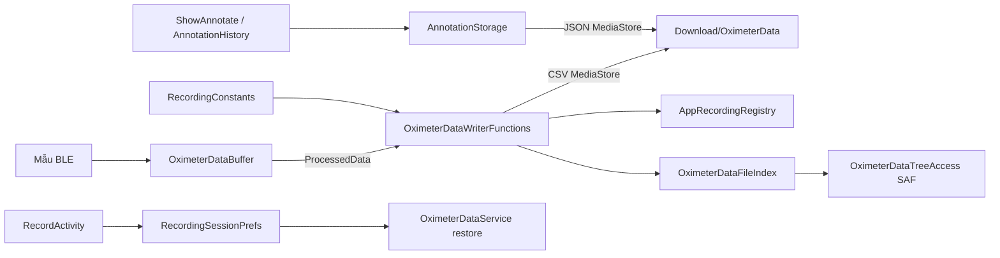
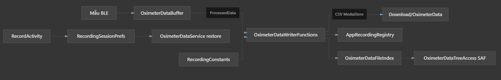

# Module — Data / Storage

> **Tầng 3.** Module dữ liệu & lưu trữ: gom mẫu, ghi CSV, index file, khôi phục phiên, chẩn đoán RAM.
> Chi tiết từng hàm xem [Tầng 4 — functions-data-storage.md](../4-functions/functions-data-storage.md).

**9 class:** `OximeterDataBuffer`, `OximeterDataWriterFunctions`, `OximeterDataFileIndex`, `OximeterDataTreeAccess`,
`RecordingSessionPrefs`, `RecordingConstants`, `AppRecordingRegistry`, `AnnotationStorage`, `MemoryDiagnostics`.

**Luồng:** mẫu BLE → `OximeterDataBuffer` (gom 100) → `OximeterDataWriterFunctions` (CSV qua MediaStore) →
`OximeterDataFileIndex`/`AppRecordingRegistry`/`OximeterDataTreeAccess` (liệt kê file); phiên được giữ qua `RecordingSessionPrefs`;
I/O JSON ghi chú qua `AnnotationStorage`.

---

## 1. `OximeterDataBuffer`
`app/.../OximeterDataBuffer.java` — Aggregator thread-safe: gom mẫu thô thành lô **100** (`BUFFER_SIZE`), tính median,
phát ra một dòng CSV/lô qua `OximeterDataWriterFunctions.writeProcessedDataPoint`.

- Hàng đợi `ConcurrentLinkedQueue` + cờ `AtomicBoolean isProcessing` (mỗi lúc một thread drain).
- `hr`/`o2` = **median**; `pleth`/`red`/`ir`/`perfusion` = **mảng đầy đủ** từng mẫu; timestamp = mẫu giữa lô.
- Pin quy đổi 3300–4150 mV → 0–100% (làm tròn lên).
- **Method:** `addDataPoint(...)`, `flushRemaining()`.
- **Inner:** `DataPoint` (raw, private), `ProcessedData` (một dòng CSV, public).

---

## 2. `OximeterDataWriterFunctions`
`app/.../OximeterDataWriterFunctions.java` — Quản lý phiên CSV: tạo file trong MediaStore Downloads
(`Download/OximeterData/`), ghi header + dòng, **cắt segment** theo thời gian/BLE pause/17:00, đổi tên `_unknown` khi đóng,
tùy chọn ghi file chunk StreamModel.

- **Cột CSV:** `timestamp, device_id, battery, hr, o2, spo2_status, pleth, red, ir, perfusion`.
- **Tên file:** `SmartCareCsv_{patientCode}_{startStamp}_{endStamp}.csv` (stamp `dd.MM.yyyy.HH.mm.ss`; đoạn mở dùng `unknown`).
- **Method chính:** `initialize`, `setSplitInterval`, `isRecordingActive`, `getCurrentOpenFileUriString`,
  `startNewRecording`, `writeProcessedDataPoint`, `splitFileOnBlePause`, `splitForDailyCutoff`, `endRecording`,
  `getOximeterDataPath`, `formatTimestamp`.
- **`splitFileOnBlePause`:** đóng/finalize segment hiện tại **không mở lại** file mới (tránh file chỉ còn header;
  segment kế mở khi packet đầu sau reconnect qua `ensureRecordingActive`). Segment ngắn hơn `MIN_SEGMENT_MS` giữ mở.
- Mọi state writer được đồng bộ qua `SPLIT_LOCK`. Chi tiết split: [flow-03 mục 3](../2-architecture/flow-03-data-recording.md#3-cắt-file-split--file-splitting).

---

## 3. `OximeterDataFileIndex`
`app/.../OximeterDataFileIndex.java` — Index hợp nhất các file export (`SmartCareCsv*.csv`, `Annotation_*.json`) cho 2 tab
File Manager, **gộp đa nguồn**: quét đĩa, MediaStore Downloads + Files, `AppRecordingRegistry`, và cây SAF tùy chọn.

- **Inner:** `FileEntry` (uri, displayName, sizeBytes, lastModifiedMs).
- **Method chính:** `isAppDataFileName`, `queryPendingFiles`, `queryUploadedFiles`, `refreshMediaStore(Deep)`,
  `tryDiskEntryByDisplayName`, `lookupDownloadEntry`, `notifyRecordingSaved`, `getPendingDirectory`, `getUploadedDirectory`.

---

## 4. `OximeterDataTreeAccess`
`app/.../OximeterDataTreeAccess.java` — Lưu URI cây tài liệu SAF (`ACTION_OPEN_DOCUMENT_TREE`) để liệt kê file khi
`File` trực tiếp và MediaStore đều rỗng (hay gặp trên Samsung + MTP).
**Method:** `getPersistedTreeUri`, `persistTreeUri`, `clearPersistedTreeUri`.

---

## 5. `RecordingSessionPrefs`
`app/.../RecordingSessionPrefs.java` — Lưu phiên đang ghi vào SharedPreferences để `OximeterDataService`/`RecordActivity`
khôi phục sau khi bị kill hoặc service restart (`START_STICKY`) mà không có Intent mới.
- **Khóa:** active, patientCode, chunkEnabled, chunkInterval, collectionStartMs.
- **Inner:** `Session`. **Method:** `markActive`, `clear`, `isActive`, `load`.
- Liên kết khôi phục: [flow-03 mục 5](../2-architecture/flow-03-data-recording.md#5-chống-mất-dữ-liệu--resilience).

---

## 6. `RecordingConstants`
`app/.../RecordingConstants.java` — Hằng số dùng chung cho phiên 24h:
| Hằng số | Giá trị | Ý nghĩa |
|---|---|---|
| `SPLIT_INTERVAL_HOURS` | 6 | Số giờ giữa các lần cắt CSV tự động |
| `SPLIT_INTERVAL_MS` | 21.600.000 | Như trên, đơn vị ms |
| `MIN_SEGMENT_MS` | 60.000 (60s) | Độ dài tối thiểu một segment trước khi được cắt |
| `BYTES_PER_RECORDING_HOUR` | 10 MiB (`10L * 1024 * 1024`) | Ước lượng kích thước→thời lượng (vd. File Manager) |
> `BUFFER_SIZE` (100) nằm ở `OximeterDataBuffer`, không ở đây.

---

## 7. `AppRecordingRegistry`
`app/.../AppRecordingRegistry.java` — Sổ đăng ký URI file đã ghi (JSON trong SharedPreferences) để File Manager vẫn liệt kê
được khi MediaStore thiếu `RELATIVE_PATH`/chậm (tablet Samsung).
**Method:** `registerCompletedRecording`, `markUploaded`, `queryRegistryPending`.

---

## 8. `AnnotationStorage`
`app/.../AnnotationStorage.java` — Helper MediaStore **package-private** cho ghi chú: master `Annotations.json` trong
`Download/OximeterData/Annotation/` và export `Annotation_*.json` trong `Download/OximeterData/`. Dùng bởi
`ShowAnnotate` / `AnnotationHistory` (tìm/tạo/đọc/ghi qua volume Downloads).
**Hằng số:** `FOLDER_NAME`, `ANNOTATION_SUBDIR`, `MASTER_FILE_NAME`, `MASTER_PATH_MARKER`.
**Method chính:** `masterRelativePath`, `exportRelativePath`, `findEntry`, cùng helper tạo/đọc/ghi master và export.

---

## 9. `MemoryDiagnostics`
`app/.../MemoryDiagnostics.java` — Tạo snapshot RAM thiết bị + heap JVM cho `FileLogger`/log lifecycle.
**Method:** `formatDeviceSummary`, `formatSnapshot`, `trimLevelName`.

---

## Sơ đồ tương tác / Interaction

