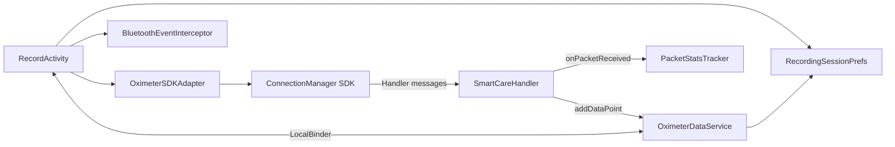
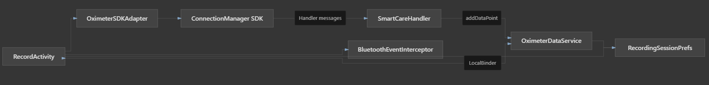

# Module — Device / Bluetooth

> **Tầng 3.** Module thiết bị & kết nối: bọc SDK của hãng, service nền ghi dữ liệu, chặn sự kiện BLE lạ.
> Chi tiết từng hàm xem [Tầng 4 — functions-device-bluetooth.md](../4-functions/functions-device-bluetooth.md).

**8 class:** `IDeviceAdapter`, `OximeterSDKAdapter`, `OximeterDataPacket`*, `OximeterDataListener`*,
`OximeterDataService`, `BluetoothEventInterceptor`, `PacketStatsTracker`, `BluetoothAutoConnector`*.

> *`OximeterDataPacket`, `OximeterDataListener`, `BluetoothAutoConnector` là **legacy — không được dùng** trong luồng
> hiện tại (giữ lại tham khảo).

**Nguyên tắc:** `RecordActivity` sở hữu UX Bluetooth và nối `OximeterSDKAdapter` (bọc `ConnectionManager` của SDK) với
`OximeterDataService`. Sự kiện SDK về qua **Handler message** (`SmartCareHandler`), **không** qua `OximeterDataListener`.

---

## 1. `IDeviceAdapter` (interface)
`app/.../device/IDeviceAdapter.java` — Trừu tượng hóa vòng đời kết nối oximeter. `RecordActivity` giữ một
`IDeviceAdapter connectionManager` với cài đặt duy nhất là `OximeterSDKAdapter`.
**Method:** `connect()`, `connect(String mac)`, `disconnect()`, `isRecording()`, `getMacAddress()`,
`getOximeterModelNumber()`, `getSampleRate()`, `startRecording()`, `onDestroy()`, `setListener()`.

---

## 2. `OximeterSDKAdapter` (implements IDeviceAdapter)
`app/.../device/OximeterSDKAdapter.java` — **File duy nhất cần sửa khi đổi phần cứng.** Bọc mỏng
`com.smartcare.oximetry.library.ConnectionManager` từ **`scolib-2.3.0`**, ủy quyền connect/disconnect/recording và truyền một `Handler`
(thường là `RecordActivity.SmartCareHandler`) để SDK gửi message.

**Đặc điểm/workaround:**
- Constructor dùng **reflection bỏ lọc tên thiết bị** (class obfuscated `...library.a`, field `d` kiểu `String[]`,
  set `names[0] = ""`) để khớp mọi thiết bị → cần xem lại khi nâng `.aar`.
- `setListener()` là **no-op** (data đi qua Handler).
- `disconnect()` chỉ chạy khi đang recording (tránh gọi thừa).

Hướng dẫn thay SDK 3 bước: [flow-02 mục 5](../2-architecture/flow-02-bluetooth-connection.md#5-thay-sdk-phần-cứng-mới--swapping-the-device-sdk).

---

## 3. `OximeterDataPacket` (POJO, legacy)
`app/.../device/OximeterDataPacket.java` — Value object cho một mẫu (pleth, SpO₂, pulse, ADC, pin…). Chỉ được
`OximeterDataListener` tham chiếu; luồng thực tế bóc `Bundle` từ `ConnectionManager` nên class này **không dùng**.

---

## 4. `OximeterDataListener` (interface, legacy)
`app/.../device/OximeterDataListener.java` — Hợp đồng callback dữ liệu/sự kiện (onDataReceived, onDeviceConnected,
onConnectionLost…). **Không được implement/gọi** — đã bị thay bằng `ConnectionManager` + Handler trong `RecordActivity`.

---

## 5. `OximeterDataService` (foreground Service)
`app/.../OximeterDataService.java` — **Trái tim ghi nền.** Buffer mẫu qua `OximeterDataBuffer`, ghi qua
`OximeterDataWriterFunctions`, giữ partial wake lock, sống sót khi bị kill nhờ `START_STICKY` + `RecordingSessionPrefs`,
expose `LocalBinder` cho `RecordActivity`.

**Method chính:** `onBind`, `onStartCommand` (xử lý null intent = process restart; trả `START_STICKY` nếu phiên active),
`onTaskRemoved` (giữ sống nếu phiên active), `startDataCollection`, `ensureRecordingActive`, `addDataPoint`,
`flushBufferedData`, `stopDataCollection`, `shutdownRecordingAsync`, `getCompletedRecordFilePath`, `isRunning`.
**Private:** `restoreSessionAfterProcessRestart`, `acquireWakeLock`, `releaseWakeLockQuietly`.
**Hằng số:** `ACTION_SPLIT_RECORDING` (broadcast cắt file 17:00).
Chi tiết chạy nền/khôi phục: [flow-03 mục 4-5](../2-architecture/flow-03-data-recording.md#4-chạy-nền--background-recording).

---

## 6. `BluetoothEventInterceptor`
`app/.../BluetoothEventInterceptor.java` — `BroadcastReceiver` ưu tiên cao bắt `ACL_CONNECTED/DISCONNECTED` **trước** SDK
và `abortBroadcast()` cho thiết bị không phải máy của ta → tránh disconnect lạ làm hỏng phiên oximeter.
**Method:** constructor (đăng ký `SYSTEM_HIGH_PRIORITY`), `setConnectedMacAddress`, `getConnectedMacAddress`, `cleanup`.
Được tạo trong `RecordActivity.onCreate()`, dọn ở `onDestroy()`.

---

## 7. `PacketStatsTracker`
`app/.../PacketStatsTracker.java` — **Singleton** theo dõi nhận/mất packet BLE để chẩn đoán qua `FileLogger`. Tách biệt với
mất mẫu do hàng đợi `OximeterDataBuffer` đầy (packet đã nhận nhưng không ghi CSV).
- **Vòng đời:** `getInstance()`, `start()` / `stop()` (ticker tổng hợp mỗi phút trên main Looper).
- **Mỗi packet:** `onPacketReceived(deviceCounter)` — phát hiện gap qua `KEY_DATA_COUNTER` của thiết bị; trả số packet
  thiếu để vẽ khoảng trống sóng.
- **Reconnect:** `onConnectionReset(reason)` xóa mốc counter để packet sau khi nối lại không bị tính thành gap khổng lồ.
- **Hằng số:** `MAX_PLAUSIBLE_GAP=1000` (gap lớn hơn → log resync, không tính mất); `GAP_LOG_THROTTLE_MS=2s`
  (giới hạn tần suất cảnh báo gap chi tiết).

---

## 8. `BluetoothAutoConnector` (legacy, không dùng)
`app/.../BluetoothAutoConnector.java` — Tiện ích auto-connect/reconnect dựa trên LE scan với hàng đợi MAC, lưu MAC bị chặn,
retry. **Không được wire vào `RecordActivity`** (Activity tự cài logic quét/reconnect riêng). Giữ lại tham khảo.
**Đáng chú ý:** dùng reflection cho `setHighPriorityConnection`, cố ý **không** mở socket SPP song song (vì `ConnectionManager`
đã giữ SPP), chu kỳ quét 2s.

---

## Bản đồ kết nối / Integration map

| Class | Có được dùng? |
|---|---|
| `OximeterSDKAdapter` | Có — `RecordActivity.onCreate()` (`scolib-2.3.0`) |
| `BluetoothEventInterceptor` | Có — tạo/cleanup trong `RecordActivity` |
| `OximeterDataService` | Có — bind từ `RecordActivity` |
| `PacketStatsTracker` | Có — singleton từ `SmartCareHandler` / reconnect |
| `BluetoothAutoConnector` | **Không** |
| `OximeterDataListener` / `OximeterDataPacket` | **Không** (legacy) |
