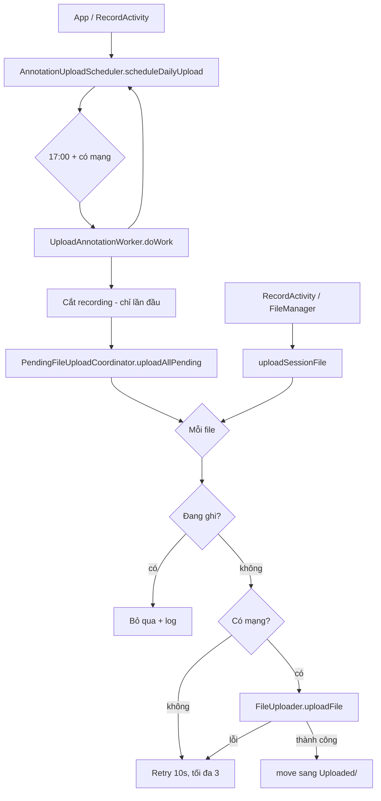

# Module — Network / Upload

> **Tầng 3.** Module mạng & upload: điều phối upload + retry, HTTP, cấu hình, lịch 17:00, log, lịch sử ghi chú.
> Chi tiết từng hàm xem [Tầng 4 — functions-network-upload.md](../4-functions/functions-network-upload.md).

**12 class:** `ApiService`, `RetrofitClient`, `UploadResponse`, `ApiConfig`, `NetworkConfig`, `FileUploader`,
`NetworkHelper`, `PendingFileUploadCoordinator`, `UploadAnnotationWorker`, `AnnotationUploadScheduler`,
`FileLogger`, `AnnotationHistory`.

| Mối quan tâm | Class |
|---|---|
| HTTP API | `ApiService` + `RetrofitClient` → `POST api/v1/file/upload` |
| Cấu hình | `ApiConfig` (URL/token từ BuildConfig), `NetworkConfig` (timeout + hằng số retry) |
| Upload thực thi | `FileUploader` (multipart, parse success, move sang Uploaded/) |
| Retry/batch/an toàn | `PendingFileUploadCoordinator` (3 lần, 10s, bỏ file đang ghi) |
| Lịch 17:00 | `AnnotationUploadScheduler` → `UploadAnnotationWorker` |
| Cổng mạng | `NetworkHelper` |
| Log | `FileLogger` | Log theo ngày `smartcare_app_log_dd.MM.yyyy.txt` (part 30MB, giữ 15 ngày) |
| UI ghi chú (JSON cục bộ) | `AnnotationHistory` |

---

## 1. `ApiService` (Retrofit interface)
`app/.../network/ApiService.java` — Định nghĩa endpoint multipart.
`Call<UploadResponse> uploadFile(@Part MultipartBody.Part file, @Part("owner") RequestBody owner)` →
`POST api/v1/file/upload`. (Các route cũ với header `x-static-token`/`x-content-md5` đã comment trong `FileUploader`.)

## 2. `RetrofitClient`
`app/.../network/RetrofitClient.java` — Singleton thread-safe tạo `Retrofit` (base URL + Gson + timeout OkHttp).
`static Retrofit getInstance()`. Timeout: connect 15s, read 20s, write 20s.

## 3. `UploadResponse`
`app/.../network/UploadResponse.java` — DTO Gson cho phản hồi server. `getMessage()` (kiểm tra success),
`getFile()` → inner `FileInfo` (`getId`, `getFilename`).

## 4. `ApiConfig`
`app/.../config/ApiConfig.java` — Hằng số `BASE_URL` (từ `BuildConfig.BASE_URL`, mặc định `http://vital-ei.oucru.org/`)
và `API_TOKEN` (từ `local.properties`, mặc định `YOUR_TOKEN_HERE`). Token hiện **không gửi** trên call active.

## 5. `NetworkConfig`
`app/.../config/NetworkConfig.java` — `CONNECT_TIMEOUT_MS=15000`, `READ_TIMEOUT_MS=20000`, `WRITE_TIMEOUT_MS=20000`
(dùng bởi RetrofitClient); `MAX_RETRY=3`, `RETRY_DELAY_MS=10000` (**chỉ tài liệu** — coordinator định nghĩa lại local).

## 6. `FileUploader`
`app/.../FileUploader.java` — Thực hiện upload multipart (content-URI hoặc path), validate message, tính MD5, move file
thành công sang `Uploaded/`. **Không tự retry** (caller lo retry).
**Method:** `setAppContext`, `uploadFile(activity, path, cb)` / `uploadFile(activity, path, uploadFileName, cb)` /
`uploadFile(path, cb)`, `moveFileToUploadedFolder(FromUri)`, `calculateMD5`, `getBaseUrl`.
**Tên upload tùy chỉnh:** overload `uploadFile(..., String uploadFileName, ...)` cho phép caller (đặc biệt
[`BugReportDialog`](module-ui-recording.md#4-bugreportdialog)) gửi tên multipart khác (vd. `SmartCareLog_{patient}_{timestamp}_.txt`)
trong khi vẫn đọc path cục bộ.
**Inner:** `UploadCallback`. Owner hardcode `"Vyyy"`; success khi message ∈
`{"File uploaded successfully!", "File uploaded successfully"}`.

## 7. `NetworkHelper`
`app/.../NetworkHelper.java` — `static boolean isNetworkAvailable(Context)` (API 23+ dùng `NetworkCapabilities`,
legacy dùng `NetworkInfo`).

## 8. `PendingFileUploadCoordinator`
`app/.../PendingFileUploadCoordinator.java` — **Trung tâm điều phối upload:** retry từng file, cổng mạng, **từ chối upload
file đang ghi**, move sang `Uploaded/` khi thành công.
**Method:** `uploadSessionFile(context, uri)` / `(context, activity, uri)`, `uploadAllPending(context)`.
**Chính sách:** `MAX_ATTEMPTS=3`, `RETRY_DELAY_MS=10000`, `IN_FLIGHT` chống upload trùng, so `getCurrentOpenFileUriString()`,
bỏ file `_unknown` 0 byte. Chi tiết: [flow-05 mục 3](../2-architecture/flow-05-file-upload.md#3-chính-sách-retry--an-toàn--retry--safety-policy).

## 9. `UploadAnnotationWorker`
`app/.../UploadAnnotationWorker.java` — WorkManager `Worker` cho bảo trì 17:00: (lần đầu) broadcast cắt recording + sleep 3s,
rồi `uploadAllPending()`, rồi `scheduleDailyUpload()` cho ngày mai. `doWork()` trả `Result.success()`.

## 10. `AnnotationUploadScheduler`
`app/.../AnnotationUploadScheduler.java` — `static scheduleDailyUpload(context)` đặt `OneTimeWorkRequest` tự nối tiếp,
tên `smartcare_daily_17h_maintenance`, ràng buộc `NetworkType.CONNECTED`, tính delay tới **17:00** local kế tiếp.

## 11. `FileLogger`
`app/.../FileLogger.java` — Ghi log chẩn đoán vào `{externalFilesDir}/Logs/` dạng file **theo ngày**
`smartcare_app_log_dd.MM.yyyy.txt` (**không** phải một file `smartcare_app_log.txt` duy nhất). Khi vượt **30MB**/ngày,
tạo part `…_2.txt`, `…_3.txt`, …. Giữ tối đa **15 ngày**; file legacy đơn không bị đổi tên/xóa.
**Helper báo lỗi** (dùng bởi [`BugReportDialog`](module-ui-recording.md#4-bugreportdialog)): `listAvailableLogFiles()`,
`appendUserReportToFile(file, detail, context)`, `formatBugReportUploadTimestamp(file[, uploadTimeMs])`.
**Method:** `getInstance`, `v/d/i/w/e`, `logEvent`, `logWarningEvent`, `logCrash`, `flushToDisk`, `getFilteredLogs`,
`getLogFilePath`, cùng các helper trên. **Enum:** `LogLevel`. **Inner:** `LogFileInfo`.

## 12. `AnnotationHistory`
`app/.../AnnotationHistory.java` — UI xem/sửa/xóa ghi chú lưu cục bộ tại `Download/OximeterData/Annotation/Annotations.json`.
**Không thuộc HTTP upload** (chỉ JSON cục bộ). `static showAnnotationHistory(context, patientCode)`. Xem [flow-04](../2-architecture/flow-04-annotation.md).

---

## Sơ đồ luồng / Flow

---

## Bảng tham chiếu retry & config / Reference

| Lớp | Retry tối đa | Delay | Ghi chú |
|---|---|---|---|
| `NetworkConfig` | 3 (`MAX_RETRY`) | 10s | Hằng số tài liệu, coordinator không import |
| `PendingFileUploadCoordinator` | **3** (`MAX_ATTEMPTS`) | **10s** | Bản thực thi retry |
| `FileUploader` | 0 | — | Một lần; code retry cũ đã comment |

| Config | Nguồn | Mặc định |
|---|---|---|
| `BASE_URL` | `app/build.gradle` → BuildConfig | `http://vital-ei.oucru.org/` |
| `API_TOKEN` | `local.properties` → BuildConfig | `YOUR_TOKEN_HERE` |
| Lịch hằng ngày | `AnnotationUploadScheduler` | **17:00** local |
| Thư mục đã upload | `FileUploader` (MediaStore) | `Download/OximeterData/Uploaded` |
