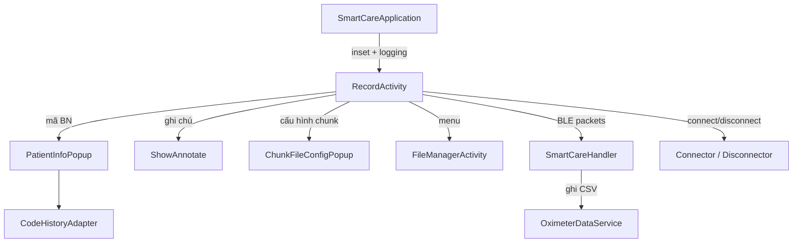

# Module — UI / Recording

> **Tầng 3.** Module giao diện: màn hình ghi, quản lý file, các popup, ghi chú, adapter và khởi tạo app.
> Chi tiết từng hàm xem [Tầng 4 — functions-ui-recording.md](../4-functions/functions-ui-recording.md).

**8 class:** `RecordActivity`, `FileManagerActivity`, `ShowAnnotate`, `AnnotationHistory`*, `PatientInfoPopup`,
`ChunkFileConfigPopup`, `CodeHistoryAdapter`, `SystemBarInsetsHelper`, `SmartCareApplication`.

> *`AnnotationHistory` được liệt kê chi tiết ở [module Network/Upload](module-network-upload.md) theo kết quả khảo sát,
> nhưng về bản chất nó thuộc UI. Ở đây ta coi nó là UI; nó chỉ thao tác JSON cục bộ.

---

## 1. `RecordActivity`
`app/.../RecordActivity.java` — **Màn hình chính** (~1900 dòng). Kết nối oximeter BLE, hiển thị pleth/HR/SpO₂/pin
thời gian thực, đẩy mẫu sang `OximeterDataService` để ghi CSV, quản lý quét/reconnect BLE, gating mã bệnh nhân, và
vòng đời phiên (cắt CSV khi BLE rớt vs dừng hẳn phiên).

**State static đáng chú ý:** `MacAddress` (MAC đang nối), `isRecordingSessionActive` (phiên có active toàn app không),
`annotationHeartRate`/`annotationSpO2` (vitals mới nhất cho ghi chú).

**Nhóm chức năng:**
- **Vòng đời:** `onCreate`, `onStop`, `onDestroy`, menu (`onCreateOptionsMenu`, `onOptionsItemSelected`).
- **Quyền:** `checkAppPermissions`, `onRequestPermissionsResult`, `requestBluetoothPermissions`.
- **Kết nối/phiên:** `connectToPulseOximeter`, `ensureServiceAndConnect`, `stopDisconnectExit`,
  `persistRecordingSessionState`, `splitCsvOnBlePause`, `restoreRecordingSessionFromPrefsIfNeeded`, `reconnectToService`.
- **UI:** `initialiseViews`, `initialisePlot`, `togglePlotVisibility`, `checkAndRequestPatientCode`.
- **BLE:** `initializeBluetoothScanning`, `startBluetoothBackgroundScan`, `scheduleAutoReconnect`, `showConnectedDevicesPopup`.

**Inner class:** `SmartCareHandler` (nhận Message từ SDK — xem [flow-02](../2-architecture/flow-02-bluetooth-connection.md#3-các-loại-message-từ-sdk--sdk-messages)),
`Connector`/`Disconnector` (AsyncTask kết nối/ngắt), `serviceConnection` (bind service).

---

## 2. `FileManagerActivity`
`app/.../FileManagerActivity.java` — Trình duyệt file 2 tab (**pending** / **uploaded**) dưới `Download/OximeterData`.
Xử lý quyền storage, fallback SAF, observer MediaStore (cập nhật live khi đang ghi), upload thủ công, mở/xóa file.

**Nhóm chức năng:** vòng đời (`onCreate/onResume/onPause/onDestroy/onActivityResult`),
file (`refreshFileLists`, `openCsvFile`, `deleteUploadedFile`), storage (`ensureStorageAccessThenLoad`,
`openOximeterDataFolderPicker`).
**Inner class:** `CsvFileAdapter` (pending), `UploadedFileAdapter` (uploaded), `CsvFile` (wrapper quanh `FileEntry`).
Chi tiết flow: [flow-06](../2-architecture/flow-06-file-management.md).

---

## 3. `ShowAnnotate`
`app/.../ShowAnnotate.java` — Thu ghi chú lâm sàng trong lúc ghi. Hiện dialog có cấu trúc, lưu vào `Annotations.json`,
xuất JSON từng note để upload, đính kèm HR/SpO₂.
**Method chính:** `showAnnotateMenu`, `showAnnotationHistory`, `updateAnnotation`, `deleteAnnotation`.
**Inner:** `AnnotationEntry` (model: timestamp, patientCode, note, heartRate, spO2). Chi tiết: [flow-04](../2-architecture/flow-04-annotation.md).

---

## 4. `PatientInfoPopup`
`app/.../PatientInfoPopup.java` — Popup nhập/chọn **mã nghiên cứu** (kèm location/serial). Lưu vào `PatientInfoPrefs`,
giữ tối đa 5 mã gần đây, **khóa app** cho tới khi nhập mã lúc khởi động.
**Method chính:** `show`, `setCancelable`, `setOnPatientInfoSavedListener`, `isCodeSaved`, `clearSavedCode`, `getSavedPatientInfo`.
**Inner:** `OnPatientInfoSavedListener`, `PatientInfo` (researchCode/locationCode/serialNumber), `TextChangeListener`.

---

## 5. `ChunkFileConfigPopup`
`app/.../ChunkFileConfigPopup.java` — Popup bật/tắt và đặt chu kỳ cắt file (StreamModel chunk). Lưu `ChunkFileConfigPrefs`,
giá trị được chuyển vào `OximeterDataService` khi connect.
**Method chính:** `show`, `isChunkFileEnabled` (mặc định false), `getTimeInterval` (mặc định 3 phút).

---

## 6. `CodeHistoryAdapter`
`app/.../CodeHistoryAdapter.java` — RecyclerView adapter cho danh sách mã bệnh nhân gần đây trong `PatientInfoPopup`.
Hỗ trợ chạm-để-điền và xóa từng dòng.
**Method chính:** `onCreateViewHolder`, `onBindViewHolder`, `updateCodes`, `removeCode`.
**Inner:** `OnCodeClickListener`, `OnCodeDeleteListener`, `CodeViewHolder`.

---

## 7. `SystemBarInsetsHelper`
`app/.../SystemBarInsetsHelper.java` — Tiện ích đệm layout gốc theo status bar / navigation bar / cutout để nội dung
không bị che. **Method:** `static apply(Activity)`. Được gọi từ `SmartCareApplication.onActivityPostCreated`.

---

## 8. `SmartCareApplication`
`app/.../SmartCareApplication.java` — Singleton ứng dụng. Khởi tạo `FileLogger`, `FileUploader`, crash handler toàn cục,
log vòng đời activity, theo dõi foreground/background, áp inset, lịch upload 17:00, chẩn đoán low-memory.
**Method chính:** `onCreate`, `onTrimMemory`, `onLowMemory`, `installCrashHandler` (private).
Chi tiết: [flow-01](../2-architecture/flow-01-app-startup.md).

---

## Sơ đồ tương tác / Interaction

